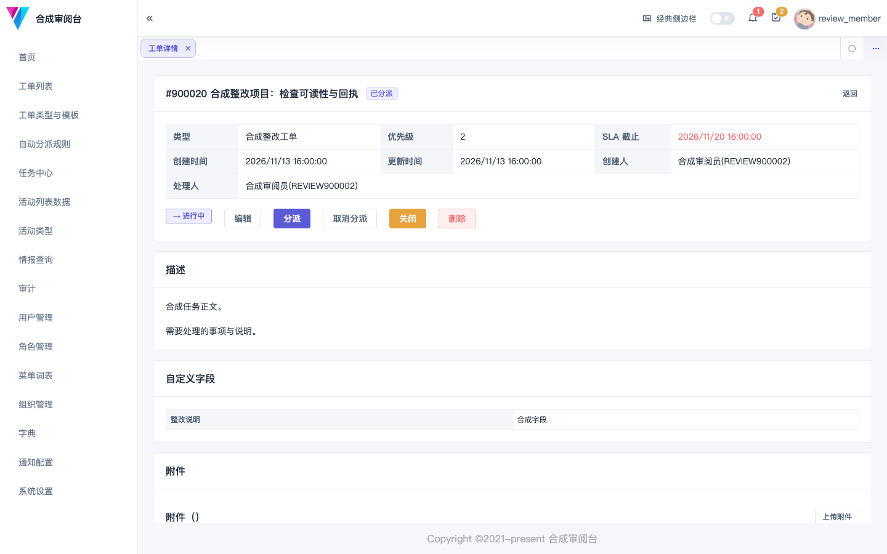
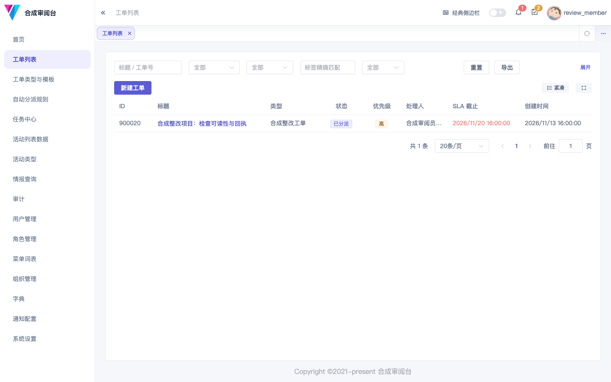

# zhuzhao

**Give security work a clear owner, a visible process, and a traceable history.**

For security and operations teams, zhuzhao brings identity, tickets, tasks, and data access into one workspace. It is evolving toward data aggregation and security lifecycle coordination, integrating specialist systems rather than rebuilding a SOC, SOAR, or CMDB.

[简体中文](README.md) · [English](README.en.md) · [Quick start](#quick-start) · [Roadmap](docs/roadmap.md) · [Contributing](docs/contributing.md)

[](https://github.com/tracerbiubiubiu/zhuzhao/actions/workflows/ci.yml?query=branch%3Amain)
[](LICENSE)



*Current Vue interface with synthetic data. The application UI is currently primarily Chinese. [Screenshot notes](docs/assets/README.md)*

## Available today

- **Identity and responsibility:** local accounts, organizations and virtual organizations, roles and menu grants; tickets use route, organization-scope, and resource-level authorization.
- **Ticket collaboration:** types, templates and custom fields, state transitions, fixed assignment rules, comments, CC participants, tags, attachments, and export.
- **Tasks and data in one console:** a task center backed by taskrunner, structured active lists backed by activelist, and intelligence queries against configured sources.
- **Traceable activity:** operation audits, ticket events, notifications, task run records, and API documentation.
- **Incremental integration:** mocks remain available alongside external interfaces, allowing behavior to be validated before connecting real providers.

Phase 5 has been accepted and merged into main. Risk lifecycle features, the new home workspace and visual redesign, enterprise UAA dual mode, a common capability runtime, and AI/Agent/MCP extensions are **planned work, not ready-to-use features**. See the [capability status](docs/review/11-project-control.md).

<details>
<summary>Preview the ticket list</summary>



</details>

## Who it is for

- Teams connecting identity and responsibility across requests, assignment, processing, review, and evidence.
- Teams with existing security and asset systems that want to connect their conclusions to accountable collaboration.
- Intranet deployments needing mocks and private adapters instead of a company-specific core fork.

The core is a Go modular monolith. The UI, task executor, active-list service, and shared library are separate repositories. Full private-extension boundaries and specialist connectors mature through their own delivery stages.

## Quick start

The current entry point is a source checkout. There is no public hosted demo or one-command full-platform demo package yet. Initial SDK, dependency, and image downloads take time. These steps start the IAM and ticket backend first.

**Prerequisites:** Git, curl, the Go version required by [go.mod](go.mod), Docker Compose v2, Make, and the `golang-migrate` CLI. Ports `5432`, `6379`, and `33333` must be available.

```bash
git clone https://github.com/tracerbiubiubiu/zhuzhao.git
cd zhuzhao
make docker-dev-up
make migrate-up
make dev
```

From another terminal:

```bash
curl --fail http://127.0.0.1:33333/health/ready
```

Start the console using the [zhuzhao-ui setup](https://github.com/tracerbiubiubiu/zhuzhao-ui), normally at `http://127.0.0.1:4000`. Test accounts are maintained in the [runbook](docs/ops/runbook.md). Tasks, lists, and object storage require their respective upstream services; see the [deployment guide](docs/ops/deployment.md) for startup order, credentials, and port overrides. A running backend alone is not the complete five-repository stack.

Local test data is disposable. `make docker-dev-reset` deletes the PG/Redis volumes declared by the current development Compose file and reruns migrations. Use it only for disposable test environments. See the [development guide](docs/guides/development.md) for isolation and reset scope.

## How it fits with specialist systems

| Layer | Responsibility | Direction in zhuzhao |
| --- | --- | --- |
| SOC / SIEM / SOAR | Detection, investigation, and specialist response | Consume conclusions, actions, and receipts while preserving the authoritative system |
| CMDB / intelligence / knowledge systems | Authoritative assets, intelligence, and knowledge | Reference controlled interfaces instead of duplicating full products |
| zhuzhao | Identity, tickets, and cross-system responsibility | Evolve the foundation toward risk closure and authorized AI consumption |

This describes responsibilities, not a performance ranking. Real connectors need provider-specific validation. Without an equivalent benchmark, there are no claims of being faster, smaller, or a specialist-platform replacement.

## Repositories

| Repository | Responsibility |
| --- | --- |
| **[zhuzhao](https://github.com/tracerbiubiubiu/zhuzhao)** | Product entry point, IAM, tickets, gateway, and ecosystem design |
| [zhuzhao-ui](https://github.com/tracerbiubiubiu/zhuzhao-ui) | Vue workspace and administration UI |
| [taskrunner](https://github.com/tracerbiubiubiu/taskrunner) | Execution, scheduling, and task-run lifecycle |
| [activelist](https://github.com/tracerbiubiubiu/activelist) | Typed, field-constrained structured lists |
| [zhuzhao-utils](https://github.com/tracerbiubiubiu/zhuzhao-utils) | Shared signing, response, error-code, and service components |

Repository and Go module names remain unchanged. A future brand migration will update the family together rather than letting documentation, modules, and images drift.

## Where the project is heading

Strengthen engineering isolation, continuous checks, correctness, and consistent UI behavior first. Validate risk and specialist collaboration separately through mocks, contracts, and real adapters. Make pages, ticket actions, schedules, and events consume the same controlled capabilities. Consume existing model APIs for authorized queries and reviewable drafts; add enterprise and bounded domain agents, then expose selected capabilities through MCP.

The [roadmap](docs/roadmap.md) explains direction; the [work ledger](docs/review/planning-backlog.md) defines bounded scope. A design document is not evidence of a shipped feature.

## Documentation and contribution

[Documentation](docs/README.md) · [Development](docs/guides/development.md) · [API](docs/api/README.md) · [Deployment and operations](docs/ops/README.md) · [Contributing](docs/contributing.md)

Reproducible issues, concrete use cases, documentation improvements, and verified adapter experience are welcome. Changes follow test-first development, small PRs, and explicit validation evidence; discuss substantial features first. Most detailed documentation is currently Chinese. This README provides an English overview with the same boundaries and startup entry points.

If this direction is useful, star the main repository to follow progress. Feedback from actual use is equally welcome.

## License

[MIT](LICENSE)
