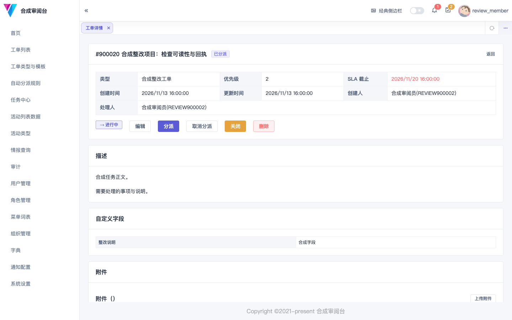
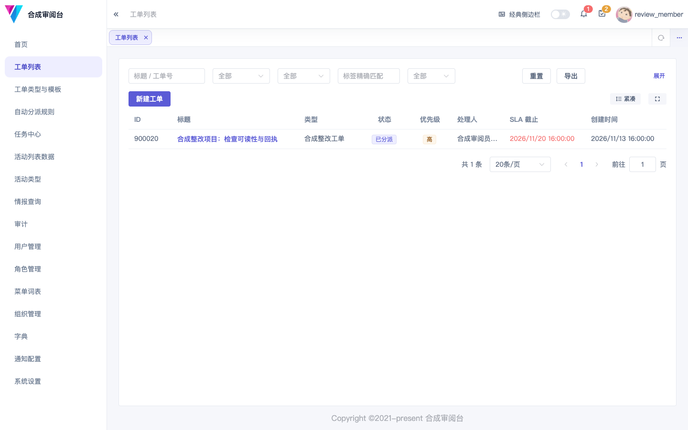

# zhuzhao

**Give security work a clear owner, a visible process, and a traceable history.**

zhuzhao gives security and operations teams one workspace for accounts and permissions, tickets, tasks, and data access. One person can file a ticket, another can take the assignment, and the owner can review the result and history. The project connects to existing systems for detection, response, and asset data.

[简体中文](README.md) · [English](README.en.md) · [Quick start](#quick-start) · [Roadmap](docs/roadmap.md) · [Contributing](docs/contributing.md)

[](https://github.com/tracerbiubiubiu/zhuzhao/actions/workflows/ci.yml?query=branch%3Amain)
[](LICENSE)



*Current Vue interface with synthetic data. The application UI is currently primarily Chinese. [Screenshot notes](docs/assets/README.md)*

## Available today

- **Control who can see and act on tickets.** The system provides local accounts, organizations, virtual organizations, roles, and menu grants. When someone opens or acts on a ticket, the system checks access to the function, the organization's scope, and access to that specific ticket.
- **Ticket collaboration:** types, templates and custom fields, state transitions, fixed assignment rules, comments, CC participants, tags, attachments, and export.
- **Tasks and data in one console:** a task center backed by taskrunner, structured active lists backed by activelist, and intelligence queries against configured sources.
- **Traceable activity:** operation audits, ticket events, notifications, task run records, and API documentation.
- **Test external integrations.** The project keeps mock services available so you can try the workflow with test data before connecting each real service.

Phase 5 has been accepted and merged into main. Risk lifecycle features, the new home workspace and visual redesign, enterprise UAA dual mode, a common capability runtime, and AI/Agent/MCP extensions are **planned work, not ready-to-use features**. See the [capability status](docs/review/11-project-control.md).

<details>
<summary>Preview the ticket list</summary>



</details>

## Who it is for

- Teams whose members file tickets, assign work across departments, and review the result and evidence.
- Teams that need to assign and track work based on findings from their existing security tools.
- Intranet deployments that need separate adapters for company services and mocks for local testing.

The core is a Go modular monolith. The UI, task executor, active-list service, and shared library are separate repositories. See the [roadmap](docs/roadmap.md) for the status of company-specific extensions and connectors.

## Quick start

The current entry point is a source checkout. There is no public hosted demo or one-command full-platform demo package yet. Initial SDK, dependency, and image downloads take time. These steps start the IAM and ticket backend first.

**Prerequisites:** Git, curl, the Go version required by [go.mod](go.mod), Docker Compose v2, Make, and the `golang-migrate` CLI. Ports `5432`, `6379`, and `33333` must be available.

```bash
git clone https://github.com/tracerbiubiubiu/zhuzhao.git
cd zhuzhao
make docker-dev-up
make migrate-up
make dev
```

From another terminal:

```bash
curl --fail http://127.0.0.1:33333/health/ready
```

Start the console using the [zhuzhao-ui setup](https://github.com/tracerbiubiubiu/zhuzhao-ui), normally at `http://127.0.0.1:4000`. Test accounts are maintained in the [runbook](docs/ops/runbook.md). Tasks, lists, and object storage require their respective upstream services; see the [deployment guide](docs/ops/deployment.md) for startup order, credentials, and port overrides. A running backend alone is not the complete five-repository stack.

Local test data is disposable. `make docker-dev-reset` deletes the PG/Redis volumes declared by the current development Compose file and reruns migrations. Use it only for disposable test environments. See the [development guide](docs/guides/development.md) for isolation and reset scope.

## How it fits with specialist systems

| Layer | Responsibility | Direction in zhuzhao |
| --- | --- | --- |
| SOC / SIEM / SOAR | Detection, investigation, and specialist response | Read findings, request approved actions, and check the result |
| CMDB / intelligence / knowledge systems | Authoritative assets, intelligence, and knowledge | Query or reference assets, intelligence, and knowledge through authorized interfaces |
| zhuzhao | Identity, tickets, and cross-system responsibility | Plan ticket creation from risks, assignment and retesting, and AI queries within the current authorization |

Each connector is validated against the service it uses.

## Repositories

| Repository | Responsibility |
| --- | --- |
| **[zhuzhao](https://github.com/tracerbiubiubiu/zhuzhao)** | Product entry point, IAM, tickets, gateway, and ecosystem design |
| [zhuzhao-ui](https://github.com/tracerbiubiubiu/zhuzhao-ui) | Vue workspace and administration UI |
| [taskrunner](https://github.com/tracerbiubiubiu/taskrunner) | Execution, scheduling, and task-run lifecycle |
| [activelist](https://github.com/tracerbiubiubiu/activelist) | Typed, field-constrained structured lists |
| [zhuzhao-utils](https://github.com/tracerbiubiubiu/zhuzhao-utils) | Shared signing, response, error-code, and service components |

Repository and Go module names remain unchanged. A future brand migration will update the family together rather than letting documentation, modules, and images drift.

## Where the project is heading

Start with test environment isolation, continuous checks, permissions, and the pages people use every day. Use mocks to test workflows, check the API contracts, and validate real adapters against their services. Route page actions, ticket actions, scheduled jobs, and events through the same controlled business entry points. Use existing model APIs for queries within the current authorization and for drafts that users can confirm. Later, connect enterprise agents, add agents for selected workflows, and expose selected capabilities through the Model Context Protocol (MCP).

The [roadmap](docs/roadmap.md) explains direction; the [work ledger](docs/planning/planning-backlog.md) defines bounded scope. A design document is not evidence of a shipped feature.

## Documentation and contribution

[Documentation](docs/README.md) · [Development](docs/guides/development.md) · [API](docs/api/README.md) · [Deployment and operations](docs/ops/README.md) · [Contributing](docs/contributing.md)

Reproducible issues, concrete use cases, documentation improvements, and verified adapter experience are welcome. Changes follow test-first development, small PRs, and explicit validation evidence; discuss substantial features first. Most detailed documentation is currently Chinese. This README provides an English overview with the same boundaries and startup entry points.

If this direction is useful, star the main repository to follow progress. Feedback from actual use is equally welcome.

## License

[MIT](LICENSE)
