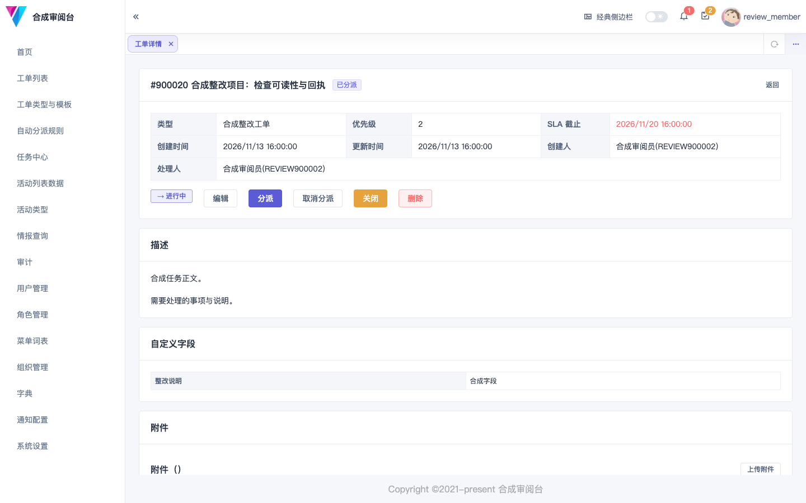
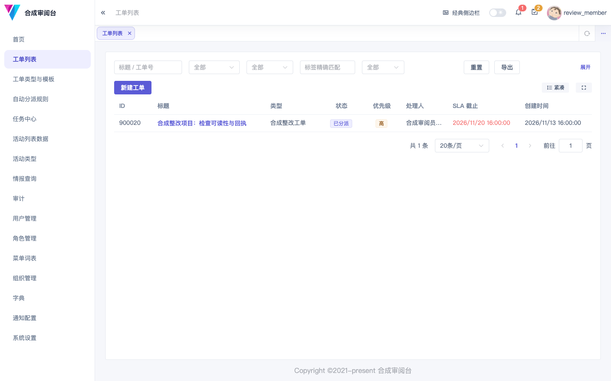

# zhuzhao

**让安全协作有明确责任、有处理过程、有可追溯记录。**

zhuzhao 给安全和运维团队提供账号权限、工单、任务和数据查询。一名同事可以提单，另一名同事接单处理，负责人再从工单查看结果和操作记录。安全检测、自动处置和资产数据优先接入已有系统。

[简体中文](README.md) · [English](README.en.md) · [快速开始](#快速开始) · [路线](docs/roadmap.md) · [参与贡献](docs/contributing.md)

[](https://github.com/tracerbiubiubiu/zhuzhao/actions/workflows/ci.yml?query=branch%3Amain)
[](LICENSE)



*现有 Vue 界面，纯合成示例数据；当前界面以中文为主。[截图说明](docs/assets/README.md)*

## 现在可以做什么

- **明确谁能看、谁能处理**。系统提供本地账号、组织与虚拟组织、角色和菜单授权。用户打开或办理工单时，系统分别检查功能权限、组织范围和针对这张工单的权限。
- **把协作留在工单里**：类型、模板与自定义字段、状态流转、固定规则分派、评论、知会、标签、附件和导出。
- **从同一工作台进入任务与数据**：任务中心接入 taskrunner，动态清单接入 activelist，威胁情报查询消费后端配置的来源。
- **保留处理依据**：操作审计、工单事件、消息通知、任务运行记录与 API 文档，方便追查和集成。
- **试接第三方服务**。项目长期保留模拟服务（mock），可以先用测试数据跑通操作，再逐个接入真实系统。

Phase 5 已验收并合入 main。风险生命周期、新首页与视觉改版、企业 UAA 双模式、统一能力调用及 AI／Agent／MCP 扩展仍是后续建设内容，**不属于当前开箱即用功能**。准确状态见[项目控制台](docs/review/11-project-control.md)。

<details>
<summary>查看工单列表预览</summary>



</details>

## 适合哪些场景

- 员工提交工单，另一部门接单处理，复核人需要看到过程和证据。
- 安全工具已经发现问题，需要把结论交给同事处理，并从工单跟进结果。
- 在内网接入企业服务，用独立的对接程序（adapter）处理企业接口，并保留模拟服务供本地测试。

核心采用 Go 模块化单体；前端、任务执行、动态清单和公共库分别维护。企业专用扩展和各类连接器的开发状态见[路线图](docs/roadmap.md)。

## 快速开始

目前提供源码启动，尚无公开在线演示或全平台一键体验包。首次下载 SDK、依赖和镜像需要时间；下面先启动 IAM 与工单后端。

**前置**：Git、curl、满足 [go.mod](go.mod) 的 Go、Docker Compose v2、Make、`golang-migrate` CLI；本地端口 `5432`、`6379`、`33333` 可用。

```bash
git clone https://github.com/tracerbiubiubiu/zhuzhao.git
cd zhuzhao
make docker-dev-up
make migrate-up
make dev
```

另开终端检查就绪：

```bash
curl --fail http://127.0.0.1:33333/health/ready
```

界面请按 [zhuzhao-ui 的启动步骤](https://github.com/tracerbiubiubiu/zhuzhao-ui)启动，默认地址 `http://127.0.0.1:4000`；测试账号以[运行手册](docs/ops/runbook.md)台账为准。任务、清单和对象存储还需要相应上游；完整顺序、密钥与端口配置见[部署指南](docs/ops/deployment.md)。这些命令不等于五仓全栈已经启动。

本地测试数据可以重建。需要清空时，`make docker-dev-reset` 会删除当前开发 Compose 声明的 PG／Redis 卷并重新迁移；仅用于可丢弃的测试环境。隔离与重建范围见[开发指南](docs/guides/development.md)。

## 与专业平台如何分工

| 层次 | 负责什么 | 本项目方向 |
| --- | --- | --- |
| SOC／SIEM／SOAR | 专业发现、研判和处置执行 | 通过接口取检测结论、发起获准动作并查执行结果 |
| CMDB／情报／知识平台 | 资产、情报与知识权威 | 按权限查询或引用资产、情报与知识数据 |
| zhuzhao | 身份、工单与跨系统责任协作 | 计划从风险开工单、分派和复测，并支持在当前授权范围内查询的 AI 助手 |

每个连接器用它实际对接的服务单独验收。

## 项目组成

| 仓库 | 职责 |
| --- | --- |
| **[zhuzhao](https://github.com/tracerbiubiubiu/zhuzhao)** | 产品主入口、IAM、工单、网关与生态设计 |
| [zhuzhao-ui](https://github.com/tracerbiubiubiu/zhuzhao-ui) | Vue工作台与管理界面 |
| [taskrunner](https://github.com/tracerbiubiubiu/taskrunner) | 任务执行、调度与运行生命周期 |
| [activelist](https://github.com/tracerbiubiubiu/activelist) | 有类型与字段约束的结构化动态清单 |
| [zhuzhao-utils](https://github.com/tracerbiubiubiu/zhuzhao-utils) | 服务间签名、响应、错误码等公共组件 |

当前仓名与 Go module 不变；新品牌确定后再统一迁移，避免文档、模块和镜像各用一套名字。

## 下一步方向

先补测试环境隔离、持续检查、权限和日常页面。风险与专业平台对接时，分别用模拟服务试业务流程、核对接口约定，并用真实适配器验对接结果。页面、工单、定时任务和事件逐步通过同一套受控入口调用业务功能。AI 先用已有模型 API 在当前授权范围内查询并生成供确认的草稿，后续再接企业智能体、支持有限的业务智能体，并通过模型上下文协议（MCP）开放选定功能。

[路线图](docs/roadmap.md)说明方向，[总账](docs/planning/planning-backlog.md)说明范围和顺序；设计存在不代表功能已交付。

## 文档与贡献

[文档入口](docs/README.md) · [开发](docs/guides/development.md) · [API](docs/api/README.md) · [部署运维](docs/ops/README.md) · [贡献指南](docs/contributing.md)

欢迎可复现问题、具体业务场景、文档改进与经过验证的适配经验。采用测试先行、小批PR和明确验证证据；大功能先讨论范围。详细文档目前主要为中文，英文README提供相同能力边界与启动入口。

如果这个方向对你有帮助，可以 Star 主仓关注后续进展；实际使用反馈同样有价值。

## License

[MIT](LICENSE)
