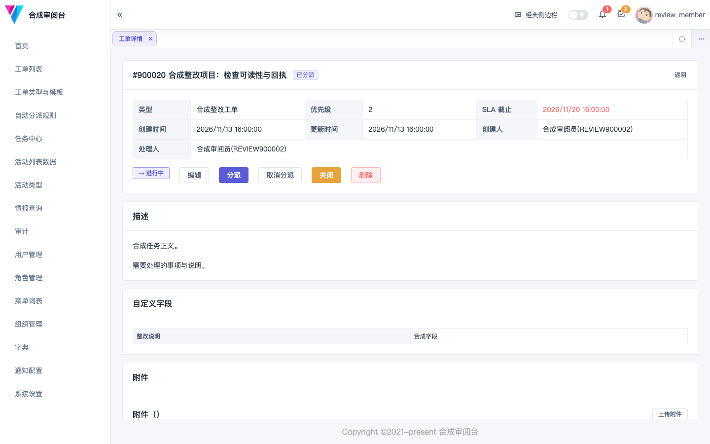
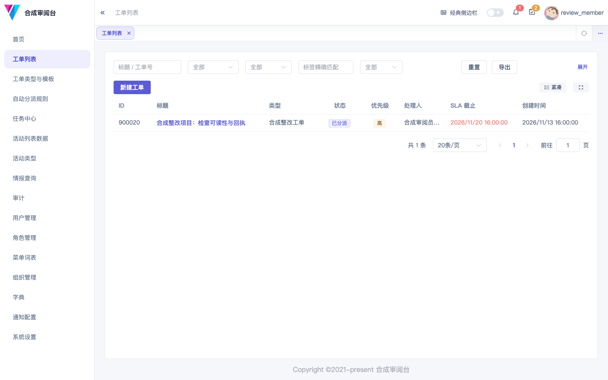

# zhuzhao

**让安全协作有明确责任、有处理过程、有可追溯记录。**

面向安全与运维团队，以 IAM、工单、任务和数据查询连接分散的协作入口，逐步打通安全数据聚合与全生命周期管控。专业安全能力优先接入已有平台，避免再造一套 SOC、SOAR 或 CMDB。

[简体中文](README.md) · [English](README.en.md) · [快速开始](#快速开始) · [路线](docs/roadmap.md) · [参与贡献](docs/contributing.md)

[](https://github.com/tracerbiubiubiu/zhuzhao/actions/workflows/ci.yml?query=branch%3Amain)
[](LICENSE)



*现有 Vue 界面，纯合成示例数据；当前界面以中文为主。[截图说明](docs/assets/README.md)*

## 现在可以做什么

- **明确谁能看、谁能处理**：本地账号、组织与虚拟组织、角色和菜单授权；工单使用路由、组织范围和资源级三层鉴权。
- **把协作留在工单里**：类型、模板与自定义字段、状态流转、固定规则分派、评论、知会、标签、附件和导出。
- **从同一工作台进入任务与数据**：任务中心接入 taskrunner，动态清单接入 activelist，威胁情报查询消费后端配置的来源。
- **保留处理依据**：操作审计、工单事件、消息通知、任务运行记录与 API 文档，方便追查和集成。
- **渐进接入**：mock 长期保留，先验证协作流程，再逐个适配真实系统。

Phase 5 已验收并合入 main。风险生命周期、新首页与视觉改版、企业 UAA 双模式、统一能力调用及 AI／Agent／MCP 扩展仍是后续建设内容，**不属于当前开箱即用功能**。准确状态见[项目控制台](docs/review/11-project-control.md)。

<details>
<summary>查看工单列表预览</summary>



</details>

## 适合哪些场景

- 统一身份与职责，把跨部门提单、分派、处理、复核和证据串起来。
- 已有专业安全和资产平台，希望逐步聚合结论，补齐跨系统责任与协作。
- 内网二次开发需要保留 mock，通过独立 adapter 接企业接口，减少核心分叉。

核心采用 Go 模块化单体；前端、任务执行、动态清单和公共库分别维护。完整私有扩展接缝和专业连接器的成熟度按各自路线推进。

## 快速开始

目前提供源码启动，尚无公开在线演示或全平台一键体验包。首次下载 SDK、依赖和镜像需要时间；下面先启动 IAM 与工单后端。

**前置**：Git、curl、满足 [go.mod](go.mod) 的 Go、Docker Compose v2、Make、`golang-migrate` CLI；本地端口 `5432`、`6379`、`33333` 可用。

```bash
git clone https://github.com/tracerbiubiubiu/zhuzhao.git
cd zhuzhao
make docker-dev-up
make migrate-up
make dev
```

另开终端检查就绪：

```bash
curl --fail http://127.0.0.1:33333/health/ready
```

界面请按 [zhuzhao-ui 的启动步骤](https://github.com/tracerbiubiubiu/zhuzhao-ui)启动，默认地址 `http://127.0.0.1:4000`；测试账号以[运行手册](docs/ops/runbook.md)台账为准。任务、清单和对象存储还需要相应上游；完整顺序、密钥与端口配置见[部署指南](docs/ops/deployment.md)。这些命令不等于五仓全栈已经启动。

本地测试数据可以重建。需要清空时，`make docker-dev-reset` 会删除当前开发 Compose 声明的 PG／Redis 卷并重新迁移；仅用于可丢弃的测试环境。隔离与重建范围见[开发指南](docs/guides/development.md)。

## 与专业平台如何分工

| 层次 | 负责什么 | 本项目方向 |
| --- | --- | --- |
| SOC／SIEM／SOAR | 专业发现、研判和处置执行 | 接入结论、动作及回执，保留专业写主 |
| CMDB／情报／知识平台 | 资产、情报与知识权威 | 通过受控接口引用，避免复制完整产品 |
| zhuzhao | 身份、工单与跨系统责任协作 | 从现有底座扩展风险闭环与受权AI消费 |

这是职责对照，不是性能排名。连接器按来源分别验收；没有同环境基准，不宣称更快、更轻或可替代专业平台。

## 项目组成

| 仓库 | 职责 |
| --- | --- |
| **[zhuzhao](https://github.com/tracerbiubiubiu/zhuzhao)** | 产品主入口、IAM、工单、网关与生态设计 |
| [zhuzhao-ui](https://github.com/tracerbiubiubiu/zhuzhao-ui) | Vue工作台与管理界面 |
| [taskrunner](https://github.com/tracerbiubiubiu/taskrunner) | 任务执行、调度与运行生命周期 |
| [activelist](https://github.com/tracerbiubiubiu/activelist) | 有类型与字段约束的结构化动态清单 |
| [zhuzhao-utils](https://github.com/tracerbiubiubiu/zhuzhao-utils) | 服务间签名、响应、错误码等公共组件 |

当前仓名与 Go module 不变；新品牌确定后再统一迁移，避免文档、模块和镜像各用一套名字。

## 下一步方向

先补工程隔离、持续检查、正确性与统一界面；以 mock／合同／真实 adapter 分层验证风险和专业平台协作。同一业务能力逐步由页面、工单、计划和事件共用受控路径；只调用已有模型API，渐进支持受权查询、可确认草案、企业Agent与有限领域Agent，再按需封装MCP。

[路线图](docs/roadmap.md)说明方向，[总账](docs/review/planning-backlog.md)说明范围和顺序；设计存在不代表功能已交付。

## 文档与贡献

[文档入口](docs/README.md) · [开发](docs/guides/development.md) · [API](docs/api/README.md) · [部署运维](docs/ops/README.md) · [贡献指南](docs/contributing.md)

欢迎可复现问题、具体业务场景、文档改进与经过验证的适配经验。采用测试先行、小批PR和明确验证证据；大功能先讨论范围。详细文档目前主要为中文，英文README提供相同能力边界与启动入口。

如果这个方向对你有帮助，可以 Star 主仓关注后续进展；实际使用反馈同样有价值。

## License

[MIT](LICENSE)
