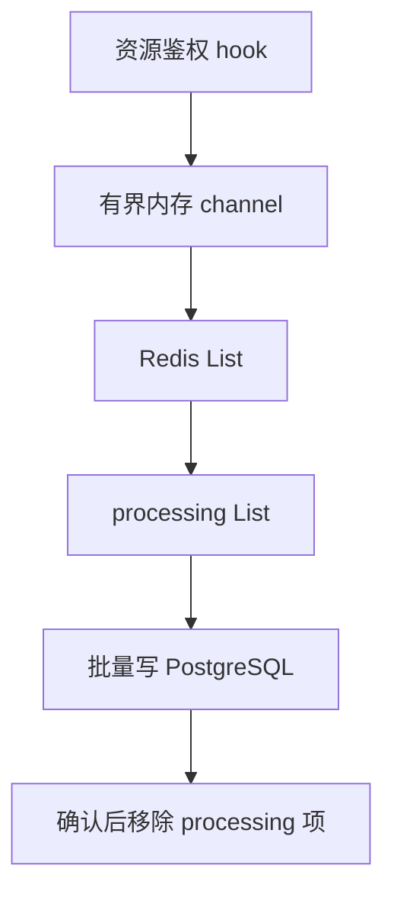

# 审计：操作记录、权限判定与归档

> 当前实现说明，2026-11-08 校准。HTTP 操作审计与资源权限判定日志有不同写入链路和丢失边界；排查时先确定要找哪一种。历史方案见 [Phase 1 审计](../phase1/08-audit.md) 与 [Phase 3 审计 L2](../phase3/03-audit-l2.md)。

> 2026-11-13后继目标见[统一日志审计合同](../design/unified-observability-audit.md)：HTTP请求记录不能代替同用例、同事务可信业务审计。新合同不将下述fail-open和归档链路冒报为已改造；正式切换保留迁移/验证窗口。

## 1. HTTP 操作审计

`internal/middleware/audit.go` 的 `AuditLog` 在受保护路由中包住 Casbin 和 Handler。它读取并还原请求体，等待业务完成，先 Flush 响应，再通过 `AuditLogger.Insert` 同步入库 `audit_logs`。登录结果由认证服务单独记录，不能假设公开登录路由经过了该中间件。

写入使用 `context.WithoutCancel` 加独立 3 秒超时，客户端断连不会直接取消写入；失败只记应用日志，不改变已经返回的业务结果。因此“业务成功”不等于“审计必定入库”。`GET /api/v1/audit/logs` 提供管理查询；按工号检索保留对软删用户历史的解析。

### 请求体与响应摘要

`maskSensitive` 先解析完整 JSON，再递归遍历嵌套对象和数组，按大小写不敏感规则遮蔽密码、secret、token 及 `*_token` 等字段，最后截断至 2 KiB 加标记。非对象或非法 JSON 保存长度占位，不把原文落库。不要复制“先截断再解析，失败原样保存”的旧伪代码。

响应摘要最多捕获 512 B，并由摘要逻辑脱敏。配置的反代前缀跳过请求体和响应体捕获，仍写操作元数据，避免破坏流式传输。规则由代码和测试维护，不存在旧方案所列的任意 `audit.sensitive_fields` 动态配置能力。

## 2. 资源权限判定日志

`internal/pkg/audit/policyeval.go` 的 `PolicyEvalWriter` 接收资源鉴权结果，写入 `policy_evaluation_logs`，不是 HTTP 审计的异步替代实现。

判定日志采用已拍板的 fail-open：channel 满或推送 Redis 失败时可丢行并告警，不能阻断业务鉴权。进程崩溃会丢尚未推送的内存记录；已进入 Redis List / processing 的记录可继续消费，持久性仍取决于 Redis 实际持久化与备份配置。数据库失败保留 processing 待重试；退出需先等待 writer，再关 Redis。

2026-11-13静态复查：共享processing的读取/落库/裁剪尚无逐消费者claim/ACK保证，不能将单消费者恢复设计推定为多实例无丢/无重；OBS03在多worker正式启用前交对应反例、修正与恢复证据。本轮未修改该运行代码，也未以静态推演冒充真实并发复现。

例如一次工单读取可能同时产生 HTTP 操作记录和资源判定记录。前者回答“谁请求了什么、返回什么”，后者解释“资源动作为什么获准或拒绝”；两表不能相互替代，也不能用其中一张的数量证明另一条链路无丢失。

## 3. 先归档，再删除

`internal/service/audit_archive.go` 的 `AuditArchiveJob.Handle` 每次对两张审计表各处理一个有界批次：读取超期行 → 写 JSONL → Sync 成功 → 删除同批 ID。单表失败继续尝试另一表，最终返回错误供调度侧观察或重试。

文件已写、数据库未删时崩溃，重跑可能重复导出；归档消费者应按原记录标识去重。默认库内保留期 180 天、文件保留期 395 天，实际以配置为准。归档目录在构造时解析为绝对路径，必须挂持久卷并纳入备份；容器临时文件不构成长期保存。

进程内 cron 与 taskrunner 旧回调二选一启用，切换见 [cron 迁移说明](../ops/cron-migration.md)。不要另加裸 `DELETE` 定时器跳过导出。恢复见 [备份手册](../ops/backup.md)。

## 4. 历史边界与验证

独立 `access_logs` 表、actionRegistry 和通用“HTTP channel 异步写入”是旧方案候选，不是当前已交付能力。当前表结构以实际迁移和 [迁移地图](../review/11-project-control.md) 为准，不再复制第二套 DDL。

验证入口包括 `internal/middleware/audit_nested_redaction_test.go` 的嵌套脱敏测试、`internal/service/audit_archive_integration_test.go` 的归档故障与重入测试、`internal/pkg/audit/policyeval_test.go` 的 writer 生命周期测试。新增敏感字段须同时核请求与响应路径。

## 变更记录

| 日期 | 变更 |
|---|---|
| 2026-11-08 | 拆清 HTTP / 判定日志两条链；移除不安全脱敏、裸删除示例和绝不丢承诺，补归档边界。 |
