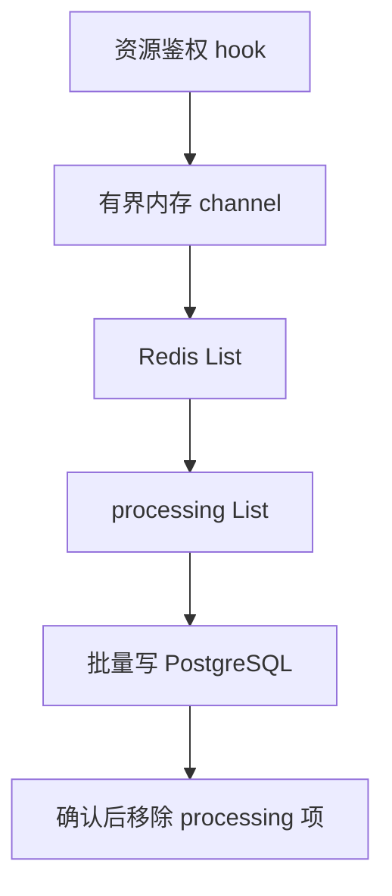

# 审计：操作记录、权限判定与归档

> 当前实现说明，2026-11-08 校准。HTTP 操作审计与资源权限判定日志有不同写入链路和丢失边界；排查时先确定要找哪一种。历史方案见 [Phase 1 审计](../phase1/08-audit.md) 与 [Phase 3 审计 L2](../phase3/03-audit-l2.md)。

> 2026-11-13后继目标见[统一日志审计合同](../design/unified-observability-audit.md)：HTTP请求记录不能代替同用例、同事务可信业务审计。新合同不将下述fail-open和归档链路冒报为已改造；正式切换保留迁移/验证窗口。

## 1. HTTP 操作审计

`internal/middleware/audit.go` 的 `AuditLog` 在受保护路由中包住 Casbin 和 Handler。它读取并还原请求体，等待业务完成，先 Flush 响应，再通过 `AuditLogger.Insert` 同步入库 `audit_logs`。登录结果由认证服务单独记录，不能假设公开登录路由经过了该中间件。

写入使用 `context.WithoutCancel` 加独立 3 秒超时，客户端断连不会直接取消写入；失败只记应用日志，不改变已经返回的业务结果。因此“业务成功”不等于“审计必定入库”。`GET /api/v1/audit/logs` 提供管理查询；按工号检索保留对软删用户历史的解析。

### 请求体与响应摘要

`maskSensitive` 先解析完整 JSON，再递归遍历嵌套对象和数组，按大小写不敏感规则遮蔽密码、secret、token 及 `*_token` 等字段，最后截断至 2 KiB 加标记。非对象或非法 JSON 保存长度占位，不把原文落库。不要复制“先截断再解析，失败原样保存”的旧伪代码。

响应摘要最多捕获 512 B，并由摘要逻辑脱敏。配置的反代前缀跳过请求体和响应体捕获，仍写操作元数据，避免破坏流式传输。规则由代码和测试维护，不存在旧方案所列的任意 `audit.sensitive_fields` 动态配置能力。

## 2. 资源权限判定日志

`internal/pkg/audit/policyeval.go` 的 `PolicyEvalWriter` 接收资源鉴权结果，写入 `policy_evaluation_logs`，不是 HTTP 审计的异步替代实现。

判定日志采用已拍板的 fail-open：channel 满或推送 Redis 失败时可丢行并告警，不能阻断业务鉴权。进程崩溃会丢尚未推送的内存记录；已进入 Redis List / processing 的记录可继续消费，持久性仍取决于 Redis 实际持久化与备份配置。数据库失败保留 processing 待重试；退出需先等待 writer，再关 Redis。

2026-11-13静态复查：共享processing的读取/落库/裁剪尚无逐消费者claim/ACK保证，不能将单消费者恢复设计推定为多实例无丢/无重；OBS03在多worker正式启用前交对应反例、修正与恢复证据。本轮未修改该运行代码，也未以静态推演冒充真实并发复现。

例如一次工单读取可能同时产生 HTTP 操作记录和资源判定记录。前者回答“谁请求了什么、返回什么”，后者解释“资源动作为什么获准或拒绝”；两表不能相互替代，也不能用其中一张的数量证明另一条链路无丢失。

## 3. 先归档，再删除

`internal/service/audit_archive.go` 的 `AuditArchiveJob.Handle` 每次对两张审计表各处理一个有界批次：读取超期行 → 写 JSONL → Sync 成功 → 删除同批 ID。单表失败继续尝试另一表，最终返回错误供调度侧观察或重试。

文件已写、数据库未删时崩溃，重跑可能重复导出；归档消费者应按原记录标识去重。默认库内保留期 180 天、文件保留期 395 天，实际以配置为准。归档目录在构造时解析为绝对路径，必须挂持久卷并纳入备份；容器临时文件不构成长期保存。

进程内 cron 与 taskrunner 旧回调二选一启用，切换见 [cron 迁移说明](../ops/cron-migration.md)。不要另加裸 `DELETE` 定时器跳过导出。恢复见 [备份手册](../ops/backup.md)。

### 3.1 维护动作的准入（2026-11-17候选）

> 本小节是 2026-11-17 候选合同的边界清单：先看批准状态与授权来源，再看保留值覆盖、taskrunner 准入与两种后台归档来源。各条只拆分排版，规则以原表述为准。

- **批准与交付状态**：本批存量窄修按已确认[TASK-D01](../phase6/task-activelist-message-detail.md#83-存量任务窄修复准确接线与参数归因)实现，完整适用门禁与组合复验已通过，见[正式修复报告](../review/reports/audit-baseline-repair-2026-11-17.md)；三功能修复已通过PR合入main，main承接见[三仓合入记录](../review/reports/audit-baseline-main-merge-2026-11-17.md)，未部署，完整IAM-C/C03仍未交付。
- **登记范围**：`internal/service/task_action_policy.go`的`TaskActionPolicy`目前仅登记实际敏感动作`audit_archive`；其他既有非敏感profile保留原行为。
- **人工维护授权来源**：使用`taskrunner.maintenance.maintainer_user_ids`的稳定本地用户ID独立授权，默认空。`TASK_MAINTAINER_USER_IDS`以逗号ID替代整个列表；显式空值在重启后撤销全部人工grant。
- **配置不是在线授权管理**：修改后须重启；撤掉L1按钮不等于撤掉该独立grant。入口仍须通过原JWT/L1，Service另核可信上下文ID、显式grant及当前未禁用/未软删账号，`actor="system"`、角色名称、`task:submit`、审计读权限与body的`created_by`均不能制造维护权。
- **保留值**：默认/缺省/零`retention_days`沿`audit.archive.retention_days`（默认180）；允许显式写同一默认值。负数、null保留值、非整数、未知键、重复键及超过36500天拒绝。
- **人工任务临时改保留期**。非默认值必须附`approval_id`，命中启动配置`overrides`的`id/user_id/retention_days/valid_from/valid_until/reason`，且真人、精确值和半开有效窗口均匹配；批准不能由body自报。窗口用RFC3339，持久比较统一为UTC微秒精度。文件保留期、目录和表名仍只由服务配置决定。
- **taskrunner 准入事实**：`TaskrunnerService.Submit/Trigger`先在迁移000082的`maintenance_task_admissions`写不可改准入事实，再远程提交；它是资格证据，不是成功收据。相同task_id不能换主体、参数或批准。更新定义经受签`GetJob`读原值，仅合现有JobPatch白名单；action/trigger_type/creator不随伪造字段改变。
- **敏感Trigger与跨库窗口**：敏感Trigger预分配task_id并携带expected_action/expected_params，TR在本地事务条件复核后保留job/run关联；两库之间没有原子事务，远程拒绝可留下未执行的事实；资格检查后到远程受理仍有窗口，期间账号撤权可留下随后被最终资格拒绝的run，不能声称跨库零新run。Retry按原task快照和当前资格复验，不为无事实的旧敏感任务补授权。
- **开通 Taskrunner 固定归档任务**。默认不开通。固定任务只接受配置默认保留期，携带人工批准号 `approval_id` 即拒绝。需在`fixed_jobs`绑定`job_id/definition_sha256/valid_from/valid_until/reason`，摘要由`MaintenanceDefinitionDigest`对审查后的完整执行定义计算（排除运行时间/next_run，参数严格规范化）。可先创建停用job，审查将启用的定义后配置绑定并重启，再按该定义启用。
- **Taskrunner 固定归档任务的回调核验**。须从真实GetTask证明job_id、无人工request_id/submitted_by、enqueue不早于批准起点，且当前GetJob仍启用、cron且摘要匹配。旧队列、仅自称system、过期/改定义均拒绝。该跨网络复核不锁住之后的远程编辑，不宣称跨库事务。
- **新建敏感cron**：必须先停用；TR分配新job_id前不能证明固定任务绑定，body所填的既有job_id不授予新定义批准。已声明字段只接受原有小写拼写，与声明键按大小写折叠后相同的别名也拒绝（含 Unicode 折叠）。`retention_days` 和 `approval_id` 同样检查。更新任务定义只合并 JobPatch 白名单字段；解析归档参数时拒绝未知键。其它任务的原有扩展字段仍按各自约定处理。
- **私有准入与并发**：`AuthorizeCallback`返回私有执行上下文；`AuditArchiveJob.Handle`在同一PG事务对人工账号做fresh `FOR SHARE`检查并执行取批/删除，批准窗口在提交前再核。已提交的禁用先发生则零效果；效果事务先持锁时，禁用等待其结束。启动grant撤销在重启后拒绝旧队列，不能解释成无需重启的撤权。没有该私有准入的普通Handler调用，即使参数缺省或自称system也拒绝；不能把公开action注册当作维护批准。
- **固定进程内cron（第二种后台来源）**：另一个启动时批准的后台来源：部署者显式启用并审查`audit.archive`固定定义，`App.NewApp`通过`NewFixedAuditArchiveJob`创建私有后台能力，绑定`service:zhuzhao/audit_archive`及构造时配置，不注册到公共动作表，不依赖外部actor或人工维护者名单。启用时tick须为合法正duration、库内保留期1–36500天、batch/文件保留期为正数、目录非空；无效定义拒启，关闭时不授任何后台能力。运行只准使用固定保留值，不接受临时批准或其它参数覆盖。两种归档调度仍须二选一，见[切换步骤](../ops/cron-migration.md)。这是落实既有TASK-D01固定cron合同，不新增在线批准平台。

人工维护开通、受控覆盖及固定TR job的实操见[runbook §6.4](../ops/runbook.md#64-审计维护开通与核查)。非法`TASK_MAINTAINER_USER_IDS`由服务端`Config.Validate`拒启；`Config.Load`仍可供break-glass消费连接配置，不要求应急CLI满足无关的任务启动前置。文件先写未提交DB时仍可能保留重复导出，恢复按原记录去重。

新job的creator由Service可信上下文生成；新消息规则的created_by取同一稳定用户ID，更新保留原creator/CAS，本次modifier仍由原HTTP审计记录。历史归属不批量改写，也不据此建立“我的任务”授权。

定向证据由`task_action_policy_integration_test.go`、`task_action_policy_http_integration_test.go`及`task_action_policy_test.go`覆盖：专属真人默认与批准覆盖、普通业务403/零TR调用/零删除、旧fact与重启撤grant、真实PG最终撤权锁的8轮反例。组合复验与完整普通档门禁已通过，准确验证范围见[正式修复报告](../review/reports/audit-baseline-repair-2026-11-17.md)；真实部署另行登记。

## 4. 历史边界与验证

独立 `access_logs` 表、actionRegistry 和通用“HTTP channel 异步写入”是旧方案候选，不是当前已交付能力。当前表结构以实际迁移和 [迁移地图](../review/11-project-control.md) 为准，不再复制第二套 DDL。

验证入口包括 `internal/middleware/audit_nested_redaction_test.go` 的嵌套脱敏测试、`internal/service/audit_archive_integration_test.go` 的归档故障与重入测试、`internal/pkg/audit/policyeval_test.go` 的 writer 生命周期测试。新增敏感字段须同时核请求与响应路径。

## 变更记录

| 日期 | 变更 |
|---|---|
| 2026-11-17 | 增补维护动作候选合同、独立启动grant/受控覆盖、准入事实与最终同PG事务资格边界；本批完整门禁及组合复验已通过。 |
| 2026-11-08 | 拆清 HTTP / 判定日志两条链；移除不安全脱敏、裸删除示例和绝不丢承诺，补归档边界。 |
