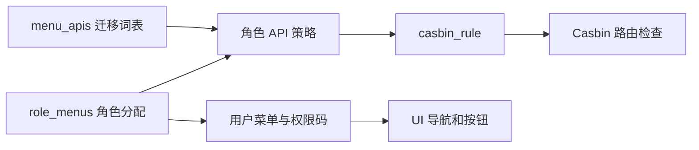

# 菜单：界面入口如何连接到 API 权限

> 当前实现说明，2026-11-08 校准。菜单词表与 `menu_apis` 通过迁移维护；生产不开放菜单 CRUD / API 绑定。角色菜单分配仍可运行时进行。历史写接口设计见 [Phase 1 菜单](../phase1/07-menu.md)。

## 1. 三种节点，各有职责

`menus` 中目录为 type=1、页面为 type=2、按钮为 type=3。页面节点提供路由与组件元数据，按钮节点提供操作权限码。菜单记录不包含 Vue 组件；新增页面需 UI 实现、菜单迁移及角色绑定同时到位。

读取入口包括 `GET /api/v1/menus`、`GET /api/v1/menus/:id`、`GET /api/v1/user/menus`、`GET /api/v1/user/permissions`，以 `internal/router/router.go` 的 `New` 为实际注册权威。`MenuService.Update` 等遗留方法存在不代表生产路由开放写入。

## 2. 从角色到菜单树

`internal/service/menu_service.go` 的 `GetUserMenus` 查有效角色 ID，取角色绑定菜单，补齐祖先，再过滤按钮、隐藏项并组树。祖先补齐解决“勾了子页面但父目录缺失”的展示问题，不会授予兄弟页面或写权限。

管理员菜单树同样依赖 `role_menus`，没有自动出现所有页面的特例。内置菜单迁移必须给 admin、superadmin 绑定，否则 API 可访问也可能没有导航入口。

`GetUserPermissions` 返回 `button:<permission>` 和 `route:<path>`。admin / superadmin 有全量目录权限码展开特例，普通角色按绑定计算。UI 用这些码决定交互，服务端仍独立鉴权；隐藏按钮不构成安全边界。

## 3. 从绑定到路由鉴权

`internal/service/rbac_service.go` 的 `AssignMenus` 在事务内更新角色菜单和策略，提交后重载 Enforcer。数据库已提交而重载失败会明确返回错误，不能把失败响应理解为已回滚。继承与资源授权见 [角色](role.md) 和 [权限地图](authz.md)。

## 4. 新增页面的核对顺序

1. 先确定页面、读接口和操作按钮。
2. 迁移写入页面/按钮并给 admin、superadmin 绑定；编号先查 [迁移地图](../review/11-project-control.md)。
3. 页面行只绑定 GET，写端点绑定按钮行。现有 ticket_list transition 例外须保留设计出处与允许表登记。
4. 启动守卫 `AuditPageWriteBindings`、目录集成测试及 acceptance Phase 1 D2 共同验证，不能靠文档声明豁免。

inbox 等身份自服务能力走自服务路由与 UI 常量入口，无需硬塞菜单授权。回滚 000075–000077 存在代码/数据库守卫耦合，操作前查 [运行手册](../ops/runbook.md)。

## 变更记录

| 日期 | 变更 |
|---|---|
| 2026-11-08 | 用当前只读能力替换退役 CRUD 草图；补管理员导航绑定、祖先补齐、策略事务和 B 案顺序。 |
