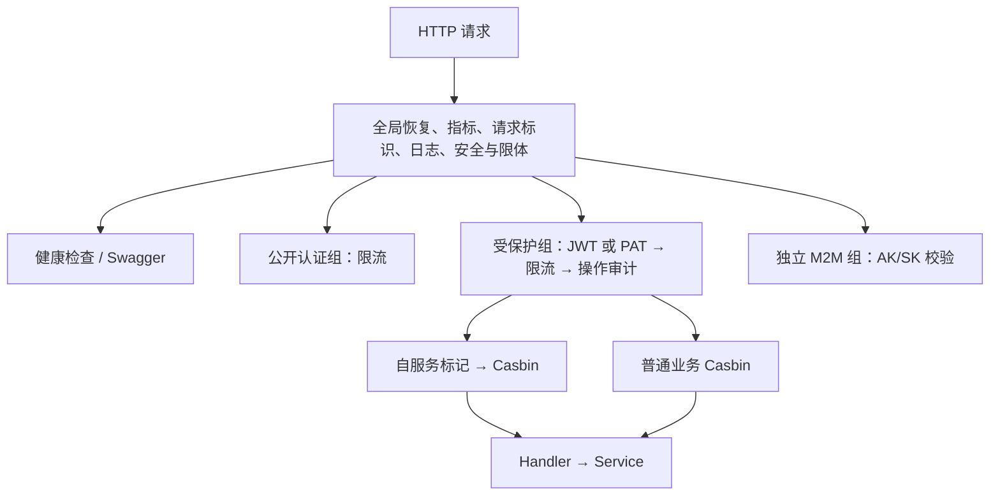

# 请求中间件：一次请求会经过什么

> 当前实现说明，2026-11-08 校准。装配权威是 `internal/router/router.go` 的 `New`；历史设计见 [Phase 1 中间件](../phase1/09-middleware.md)。本页解释请求边界，不提供第二套可复制的认证实现。

## 1. 全局链与路由组

所有请求先经过 `Recovery → MetricsMiddleware → RequestID → AccessLogger → CORS → SecurityHeaders → BodyLimit`。健康检查和 Swagger 也经过这条链，只是不进入业务 JWT / Casbin 组。所有入口仍受全局1 MiB body上限约束。配置的网关前缀只跳过审计请求体/响应体捕获，并不豁免BodyLimit；超限返回413，不向上游转发。更大导入需走已定运维通道，不能把activelist直连1 GiB契约套到网关。

公开认证组只有验证码、登录和刷新等显式注册入口。登出与改密在受保护自服务组；`/auth/*` 不是整组免认证。自服务标记必须先于 `CasbinAuth` 安装，仍要求有效身份及相应角色条件；附件、工单协作等入口还会在 Service 校验资源权限。

## 2. 认证先确认身份

`internal/middleware/jwt.go` 的 `JWT` 支持 Bearer JWT 与 `zpat_` PAT 两条分支，拒绝混用 Bearer 和 AK/SK。JWT 验签后用一次 Redis pipeline 检查黑名单、禁用标记、改密时间地板和密码纪元；读取异常按命令逐项拒绝，Redis 不可用返回 503，不能忽略错误后放行。正常缺键与基础设施故障有不同语义。

JWT 注入的 Gin 身份键为 `userID`、`username` 等。强制改密态仅允许既定密码更新路由。PAT 通过哈希查找有效凭据和用户，具有独立吊销语义；重置密码不会自动吊销 PAT，账号失陷处置见 [运行手册](../ops/runbook.md)。令牌生命周期见 [认证模块](auth.md)。

`CasbinAuth` 负责路由级 RBAC（L1），不是资源级授权的替代。工单的组织可见性（L2）和动作权限（L3）见 [权限地图](authz.md)。M2M 回调使用独立 AK/SK 组，不能把业务 JWT 组的例外直接套用过去。

## 3. 审计与日志时序

`AuditLog` 安装在 Casbin 前，因此进入该组后被 Casbin 拒绝的请求也可留操作审计；在更早 JWT 阶段拒绝的请求不会经过此中间件。登录结果由认证服务显式记审计。全局请求日志与入库操作审计不是同一条管道。

业务响应先 Flush，再同步写审计；写入使用脱离请求取消的独立 3 秒超时。这样减少断连造成的缺失，但数据库故障、超时和进程崩溃仍可能丢行。详情与脱敏规则见 [审计模块](audit.md)。

## 4. 其余保护与排查顺序

- `internal/middleware/logger.go` 的 `RequestID` 自行生成或传递请求标识，`AccessLogger` 用同一标识串起日志；并未使用旧示例中的 gin-contrib/requestid。
- `internal/middleware/cors.go` 的 `CORS` 当前仍为 `AllowAllOrigins`，未来白名单方案尚未自动生效。
- `internal/middleware/security.go` 的 `SecurityHeaders` 设置五个响应头。UI 静态资源的策略由 UI 部署层另外维护。
- API 通用限流已实际挂载；登录账号锁定另由认证服务与 Lua 完成，保护维度不同。

遇到 401 先查凭据种类、过期/纪元；503 查 Redis 等依赖；403 再区分 Casbin 路由拒绝与资源拒绝。用请求标识关联日志，避免打印令牌。

## 变更记录

| 日期 | 变更 |
|---|---|
| 2026-11-08 | 以实际装配链替换混合阶段伪代码，说明 PAT、四项 Redis 检查、路由组和审计失败语义。 |
