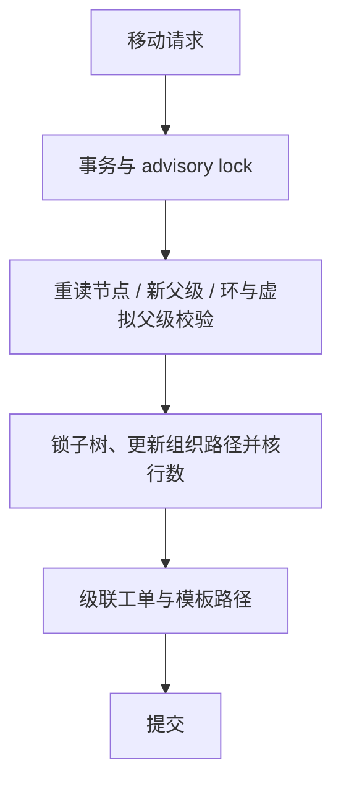

# 组织：目录、角色来源与资源范围

> 当前实现说明，2026-11-17 候选校准。实现为 `internal/service/org_service.go` 的 `OrgService`、`internal/repository/org_repo.go` 的 `OrgRepo` 和 `internal/handler/org_handler.go`，没有迁到同名子目录。历史见 [组织增强](../phase2/03-org-enhance.md) 与 [委托授权](../phase2/04-org-delegation.md)。

> 2026-11-17状态：IAM-B、当前写命令共同屏障与CF-06必要出口已通过完整适用门禁和组合复验，见[正式修复报告](../review/reports/audit-baseline-repair-2026-11-17.md)；完整IAM-C/C05及真实部署仍未交付。

## 1. 三个独立问题

- 组织树回答“部门/虚拟组挂在哪里”，使用 `parent_id` 和 PostgreSQL ltree `path`。
- `org_roles` 回答“该组织有效直接成员获得哪些平台角色”，参与角色展开；父子组织不会自动传递父组织角色。
- 成员 `ticket_scope`、实体 `ticket_visibility` 和组织委托回答“能看和管理哪些工单/成员”。这是资源范围，不能和平台角色或菜单混为一谈。

例如甲在研发部门、乙在其下虚拟组：上级的数据 scope 可以覆盖子树，但乙不会仅因树形父子关系获得研发部门绑定的角色。角色继承另走 `roles.parent_id`。

## 2. 当前模型

组织用 `is_virtual` 区分实体与虚拟组，旧 `org_type=4` 已被替代。`source`、`external_id`、`synced_at` 是目录对接字段基础，不证明 HR Job 已交付。`OrgService.Create` 要求虚拟组 code 以 `vg_` 开头并挂在实体下，不允许虚拟组父级或虚拟根节点。

`user_orgs` 记录直接成员、主组织、来源、有效期、组内档位和工单 scope。有效期须在读取授权时检查，不能仅等后台清理；过期成员不应继续贡献角色、范围或委托。`SetUserOrgsTx` 是创建用户时复用的事务写入口。

`owner_user_ids` 与派生成员 owner 档位由 `SetOwnersTx` 同步。普通成员角色更新不能设 owner，需走 `SetOwners`。scope=all 仅全局管理员可赋予；owner / admin / member 管理边界由 `internal/service/org_delegation.go` 的 `OrgDelegationService` 校验。

## 3. 当前写操作

`AddMember` / `RemoveMember` 在服务层执行委托与目标校验，已不是 Phase 1 “持路由权限即可改全部组织”。重复添加不会因未传主组织而把现有主组织降级，主组织唯一性还有数据库索引兜底。`SetUserOrgs` 是全量替换，应先确认调用方、目标列表及主组织包含关系。

`BindOrgRole` / `UnbindOrgRole` 是全局管理操作，不等于给成员设组内档位；后者走 `SetMemberRole`。`Update` 使用版本控制，`ticket_visibility` 仅实体可配置，虚拟组继承最近实体祖先语义。

实体删除与虚拟组委托删除有不同准入，仍需满足系统节点、子节点、成员和工单引用守卫。普通组织或虚拟组仍绑定未软删角色时，删除返回 50014/409，停用角色也计入。通过删除守卫后，同一事务只清理当前组织指向已软删角色的历史绑定。虚拟组 owner 派生成员也由专用事务清理。

组织绑定和角色删除共享角色锁。角色仍被组织绑定时，角色删除返回 40003/409，须先解绑。组织删除后的绑定请求也会被拒绝。

## 有效来源与成员整体替换（IAM-B候选）

2026-11-17 IAM-B候选将本组及祖先的停用状态纳入角色、菜单、scope与组织委托求值；父停子启时子树来源暂停，独立直接角色、其它有效组织及工单创建人/处理人/CC关系继续按各自规则校验。恢复只读取当前绑定与有效期限，不重建被撤或过期来源。scope先验证来源，再求最近实体anchor，不能跳过停用实体回退更高透明范围。

`internal/repository/org_authorization.go`的`OrgSourceActiveSQL`统一L1/新建成员资格的存活和祖先状态条件；`OrgDelegationActiveSQL`只对组织停用收紧，保留BK-20软删已结票委托档案的原有边界。显式owner在组织有效时仍独立于成员期限；停组不享有此例外。管理名册与绑定GET继续回显停用/过期关系。

`OrgRepo.SetUserOrgsTx`按增保删写集合：保留项不重插，不改组内角色、scope、source、expires_at及joined_at；新增项沿数据库member/assigned/local/无期限默认值。primary缺省或JSON null仍清空已有primary，显式指定须在请求集合。移除成员时清理所有不在请求集合内的owner数组引用，包括原本没有成员行的owner-only残留；请求内新增组织的合法owner-only引用保留。

本地集合请求对来源非local的现有行只允许原样保留；实际移除或改其primary先整笔拒绝并要求受权核查，不猜来源绑定的外部写主。旧软删孤儿同样不借保存隐式清理。失败时成员、primary及owner变化全部回滚。当前已启用写命令的共同授权屏障见[角色模块](role.md#6-当前写命令共同屏障)；表单expected revision、完整IAM-C/C05及停用影响预览仍未由本窄出口交付，本批组合门禁已通过，真实启用另按受审画像验收。

新增组织关系需同时遵守全局角色授予边界：`UserService.Create`的OrgIDs、`SetUserOrgs`新增项、`OrgService.AddMember`首次成员行和`SetOwners`首次派生成员行，在同一屏障/事务按潜在绑定角色核操作者启用直接角色的`canAssignRole`。暂时停用的角色、本组/祖先不会使强授予变成可种入的空集；角色父链也按当前绑定事实核验。保留的成员行不重授，原过期、scope、source和任职事实继续保留。无绑定角色的普通owner/admin成员管理保持原规则。

全局角色来源的撤予/恢复同样受控：`RemoveMember`实际删除他人成员事实时校验其潜在绑定角色，本人原来允许的离组分支保持；`Update`仅实际status变化、`Move`仅实际父节点变化、`Delete/DeleteOrgDelegated`按真实ID子树当前潜在角色绑定，核同一`canAssignRole`直接档位。展示字段、原值status/parent及无全局角色的普通委托不增加该约束。停用/到期后的目标本身仍按当前有效来源求值；合法强维护者恢复来源须承担该授予，不留下永久强账号标签。无actor签名的源命令从私有请求purpose取actor；受审内部源维护须显式`TrustedIAMInternalActor`，缺身份不默认管理员。

组织来源祖先按`parent_id`真实ID链判断；软删后复用code/path的新组织不继承历史墓碑的停用/删除。环或无法到达真实根的来源链不可验证，授权拒绝。`IsAncestorOwner`和工单委托列表谓词同样按实际ID链求祖先；最近实体anchor按真实距离选择，旧同path墓碑不能提供或遮断新组织的visibility。工单冗余org_path不再否定已由真实ID证明的历史祖先owner；`OrgRepo.Move`按parent_id收集实际组织ID子树，只向该集合中的组织行、工单和模板级联路径；真实ID后代的历史票/模板继续沿原路径变换，复用路径但属旧org_id的资料不跟随新实体移动。这仍不等于任意历史坏快照的自动修复。

工单路径只作索引候选：列表、单对象读和scope主管assign还须在票实际org_id的parent链中找到对应合格live anchor。新同path组织的anchor不再冒用旧实体身份；原实际org_id档案仍由BK20原分支处理。root等真实共同祖先的独立有效透明读/group来源，仍可覆盖其paused或历史子节点；此检查不把target整链暂停误作冻结所有外部合法来源。

## 4. 移动组织是一次事务

`OrgRepo.Move` 取得 PostgreSQL 事务级 advisory lock，重读并锁定节点与父节点，检测环及虚拟组父级约束，更新组织子树并核对组织更新行数，再同步工单和模板的组织路径。Move没有Create的20层深度检查；工单/模板级联零行合法，不作并发冲突。当前没有旧草图的 Redis SETNX 移动锁，也不依赖未交付的组织缓存广播。

移动改变数据范围，不能只更新 `parent_id`。并发验证可检索 `TestOrgRepo_MoveConcurrentCrossMove` 符号定位实际测试。

## 5. 后续边界与排查

完整 HR 同步、HR 撤销自动 Reparent 和目录对账仍属后续方案，见 [HR 提案](../proposal/hr-directory-sync.md) 与 [Phase 6](../phase6/README.md)。字段、mock Job 或虚拟组 CRUD 都不等于完整同步完成。当前 ResourceRegistry 只注册工单，不存在旧设计中的 `OrgResource` 交付。

排查“在树上却没有权限”时，依次查有效期、直接成员、角色来源、工单 scope、委托档位，再查 UI 展示；不要靠扩大平台角色掩盖资源规则。

## 变更记录

| 日期 | 变更 |
|---|---|
| 2026-11-17 | IAM-B候选补组织/祖先停用的同源求值与成员差量，保留BK-20及primary兼容，并补当前写命令fresh子出口；本批完整门禁及组合复验已通过，完整IAM-C仍后继。 |
| 2026-11-08 | 收敛为当前组织模型、事务移动及委托说明，明确 HR 与资源注册边界。 |
