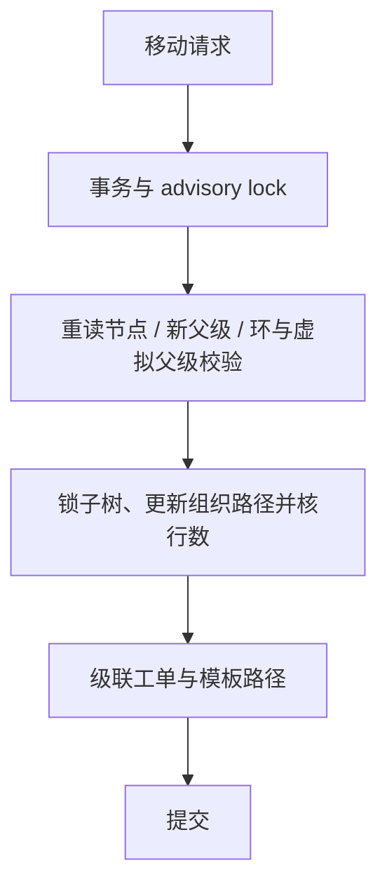

# 组织：目录、角色来源与资源范围

> 当前实现说明，2026-11-08 校准。实现为 `internal/service/org_service.go` 的 `OrgService`、`internal/repository/org_repo.go` 的 `OrgRepo` 和 `internal/handler/org_handler.go`，没有迁到同名子目录。历史见 [组织增强](../phase2/03-org-enhance.md) 与 [委托授权](../phase2/04-org-delegation.md)。

## 1. 三个独立问题

- 组织树回答“部门/虚拟组挂在哪里”，使用 `parent_id` 和 PostgreSQL ltree `path`。
- `org_roles` 回答“该组织有效直接成员获得哪些平台角色”，参与角色展开；父子组织不会自动传递父组织角色。
- 成员 `ticket_scope`、实体 `ticket_visibility` 和组织委托回答“能看和管理哪些工单/成员”。这是资源范围，不能和平台角色或菜单混为一谈。

例如甲在研发部门、乙在其下虚拟组：上级的数据 scope 可以覆盖子树，但乙不会仅因树形父子关系获得研发部门绑定的角色。角色继承另走 `roles.parent_id`。

## 2. 当前模型

组织用 `is_virtual` 区分实体与虚拟组，旧 `org_type=4` 已被替代。`source`、`external_id`、`synced_at` 是目录对接字段基础，不证明 HR Job 已交付。`OrgService.Create` 要求虚拟组 code 以 `vg_` 开头并挂在实体下，不允许虚拟组父级或虚拟根节点。

`user_orgs` 记录直接成员、主组织、来源、有效期、组内档位和工单 scope。有效期须在读取授权时检查，不能仅等后台清理；过期成员不应继续贡献角色、范围或委托。`SetUserOrgsTx` 是创建用户时复用的事务写入口。

`owner_user_ids` 与派生成员 owner 档位由 `SetOwnersTx` 同步。普通成员角色更新不能设 owner，需走 `SetOwners`。scope=all 仅全局管理员可赋予；owner / admin / member 管理边界由 `internal/service/org_delegation.go` 的 `OrgDelegationService` 校验。

## 3. 当前写操作

`AddMember` / `RemoveMember` 在服务层执行委托与目标校验，已不是 Phase 1 “持路由权限即可改全部组织”。重复添加不会因未传主组织而把现有主组织降级，主组织唯一性还有数据库索引兜底。`SetUserOrgs` 是全量替换，应先确认调用方、目标列表及主组织包含关系。

`BindOrgRole` / `UnbindOrgRole` 是全局管理操作，不等于给成员设组内档位；后者走 `SetMemberRole`。`Update` 使用版本控制，`ticket_visibility` 仅实体可配置，虚拟组继承最近实体祖先语义。

实体删除与虚拟组委托删除有不同准入，仍需满足系统节点、子节点、成员和工单引用守卫。虚拟组 owner 派生成员由专用事务清理，不能手工删行绕规则。

## 4. 移动组织是一次事务

`OrgRepo.Move` 取得 PostgreSQL 事务级 advisory lock，重读并锁定节点与父节点，检测环及虚拟组父级约束，更新组织子树并核对组织更新行数，再同步工单和模板的组织路径。Move没有Create的20层深度检查；工单/模板级联零行合法，不作并发冲突。当前没有旧草图的 Redis SETNX 移动锁，也不依赖未交付的组织缓存广播。

移动改变数据范围，不能只更新 `parent_id`。并发验证可检索 `TestOrgRepo_MoveConcurrentCrossMove` 符号定位实际测试。

## 5. 后续边界与排查

完整 HR 同步、HR 撤销自动 Reparent 和目录对账仍属后续方案，见 [HR 提案](../proposal/hr-directory-sync.md) 与 [Phase 6](../phase6/README.md)。字段、mock Job 或虚拟组 CRUD 都不等于完整同步完成。当前 ResourceRegistry 只注册工单，不存在旧设计中的 `OrgResource` 交付。

排查“在树上却没有权限”时，依次查有效期、直接成员、角色来源、工单 scope、委托档位，再查 UI 展示；不要靠扩大平台角色掩盖资源规则。

## 变更记录

| 日期 | 变更 |
|---|---|
| 2026-11-08 | 收敛为当前组织模型、事务移动及委托说明，明确 HR 与资源注册边界。 |
