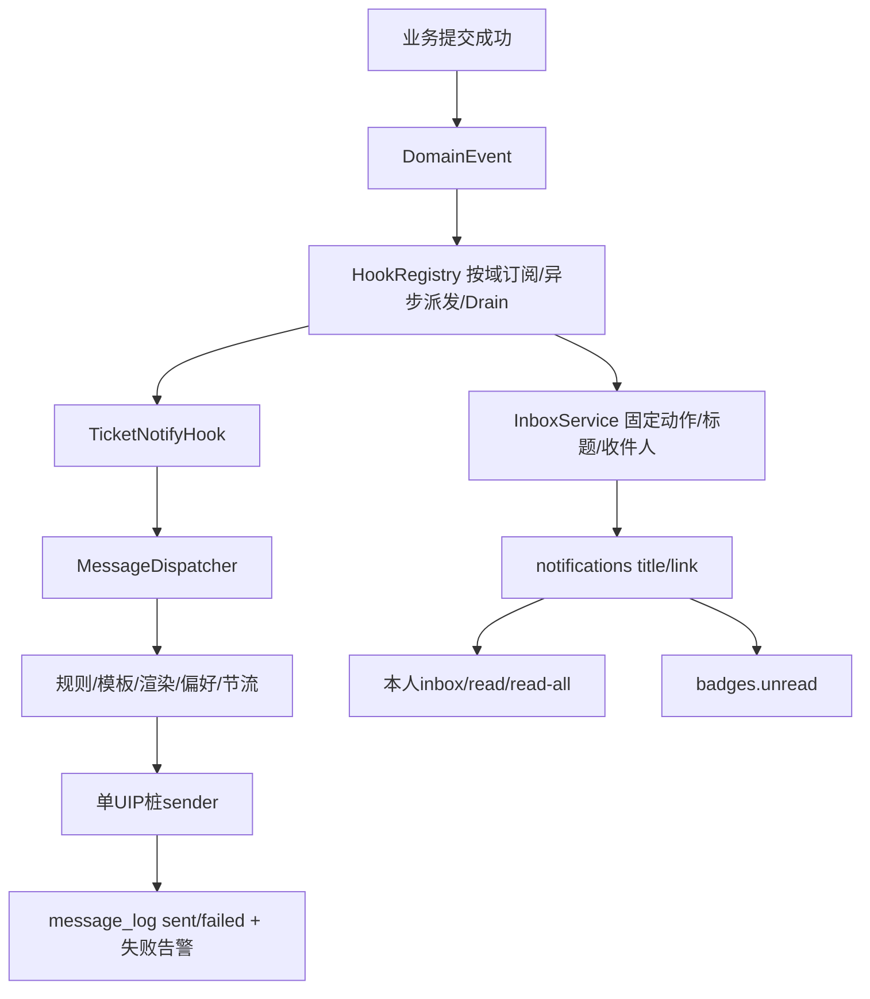

<a id="06--p5-s6-消息通知统一消息平台--模板--工单触发设计稿"></a>

# 06 — P5-S6 消息通知：统一消息平台 + 模板 + 工单触发（实施说明与设计沿革）

> **段属性**：基线段（phase5 收口对象）。**原实施序**：与 S2 错峰衔接（S1 后；单人串行——S6 一期先于 S2）；**S10 依赖本段**（抄送通知/超时通知），phase6 硬前置 = 本段**一期**口径。
> **原规划量级（非当前排期）**：一期约 2–2.5 周（通道/模板/解析/触发/记录各 2–3 天 + 事件面基建 3–5 天）+ **二期站内消息中心 1.5–2 周**（2026-10-13 翻案挂入，S6 总账 3–4 周）。**迁移**：有（一期 `message_templates`/`message_log` 两表族 + `message_rules` 订阅规则轻表（附录 A.5）+ `tickets.human_key` ALTER（拍板点 2 随批时）——**≥3 段迁移（2026-10-16 外审计数对齐）**；二期 notifications 表族——编号启动时对账，不写死）。
> **文档定位**：段级实施说明与设计来源（2026-10-15 建档，phase5 分支）。对接参考 = [phase3/10 §3 通知服务设计](../phase3/10-ticket-business.md)（邮件矩阵/事件订阅）；立项与演进 = dd §27（2026-10-08 四轮）+ 站内消息中心翻案条（2026-10-13）。
> **事件面公约注（2026-10-28 P1-7 拍板）**：进程内事件面全生态公约层 = [standards §14](../standards.md)——本段为第一消费者，机制细节锚仍在本稿（事件面基建/Drain 语义）；新域消费者按公约三件随批。

> 2026-11-07 B20当前行为：NavbarBadge以VueQuery订阅消息写操作既有失效key `badge`，已读后立即重取，60s后台同步保留；请求层处理错误，保留上份成功数据。真实E2E在reload前核角标，不以刷新掩盖失效；最终41 E2E通过，详[B20报告](../review/reports/zhuzhao-ecosystem-audit-b20-ui-feedback-2026-11-07.md)。事件可靠性/Outbox及ops收件人合同不由本批补齐。

## 当前状态与阅读顺序（2026-11-08）

一期模板/规则/外发编排与二期站内消息中心已交付，但**外发UIP仍是两态桩，站内inbox是独立消费者**。先读A.1机制、A.3真实sender、A.5两路分工与A.6真实API；管理面既有UI与事件词表边界看A.9。代码/test承接看[B27](../review/reports/zhuzhao-ecosystem-audit-b27-phase5-closeout-2026-11-07.md)及[11-08复验](../review/reports/zhuzhao-report-followup-2026-11-08.md)，main/生产另计。首轮文档整理与必要本地门禁已收口，见[整理记录](../review/reports/documentation-reorganization-2026-11-08.md)，后续修改须另记验证结果。

H-2多渠道/钉钉、H-3动态字段与时间变量、H-6 picker/preview、G-7+G-29①站内规则/偏好仍按[债台账](s6-s5-debt-ledger.md)排位；已拍不等于已实现。§2是立项历史基线，原周数和日期收据保留时点含义。



总线在进程内at-most-once，失败不回滚业务事务；没有由此获得持久重试/Outbox保证。inbox尚不消费外发rules/opt-out，图中两路不能合并成“同一通道已接线”。

<a id="15-通知能力三入口2026-10-23-对话设计批架构澄清"></a>

## 1.5 通知能力三入口

能力编排当前已实体化为`internal/service/ticket/dispatcher.go`的`MessageDispatcher.Dispatch`，B10-4出现第二个消费者时完成抽取；`TicketNotifyHook.OnDomainEvent`是薄适配器，不再保留“开工前待抽”的当前待办。

事件触发与timeout/deadline扫描都发布DomainEvent后进入该管道；扫描器只确定目标并发事件。人工触发薄端点仍待真实场景，不能写成已存在API。P4-2的`NotificationService`只管渠道配置/死信告警，与新编排层同名概念必须分开：模板/规则/渲染链指MessageDispatcher。

## 1. 定位与由来

**定位 = P4-2 通知通道的能力延伸，非 §23 翻案**：P4-2 已交付渠道配置化 webhook + 死信告警 + taskrunner 终败通知 hook（E-⑥ 形态落地）；§23 暂缓清单中"通知"一项随 P4-2 事实上解封。本段补齐三件：**统一消息平台渠道 + 消息模板 + 工单事件触发**。**本段不扩完整SLA/审批/报表**；Phase5后来已交付S3a自动分派及SLA0.5，不再把§23旧全局暂缓当当前能力状态。站内通知原"不取"（2026-10-08/09 两次拍板）——2026-10-13 所有者铃铛需求**翻案**：原口径否决的是"触达通道"，铃铛实际要"站内聚合工作面"，与钉钉/邮件互补非替代——**挂 S6 二期**（见 §6）。

<a id="2-现状基线代码级锚点2026-10-15-核实"></a>

## 2. 立项基线（历史）（代码级锚点，2026-10-15 核实）

| 项 | 现状 | 锚点 |
|----|------|------|
| 渠道配置 | P4-2 本体：`notification_configs` 表 + 管理 API 四端点；**首版仅 webhook 渠道**（`Channel` 字段就位、单渠道类型） | 迁移 `000033`；`internal/router/router.go:335-341`；`internal/model/notification.go:11` |
| 发送链 | webhook client 分发尽力而为（单渠道失败不阻断）+ 死信告警全链实测（黑洞回调→死信→webhook 送达）+ taskrunner 终败通知 hook（`TASKRUNNER_NOTIFY_*`） | `internal/service/notification_service.go:13-27`；phase4/02 P4-2 行 |
| 配置页 | **未做**（菜单 visible=false 过渡态，000033 预登记占位无视图） | router.go:335 注释；zhuzhao-ui `viewNames.test.ts:15` |
| 缺口 | **消息模板、统一消息平台渠道类型、工单事件触发挂接、发送记录** 四件零实现 | README §1 现状表 |
| 事件面 | `ticket_events` **无 event_type/processed 列**（000010:70 注释承诺的迁移编号已被 A2 挪用）——选"事件消费面"形态须先补迁移 | 迁移 000010:70；phase4/02 P4-2 行触发源注意 |

## 3. 通道层（环境红利：全渠道单接口）

- 当前`notification.uip.endpoint`用于UIP桩装配，`notification_configs`保留P4-2 webhook配置管理；不能把“配置里有uip”写成统一消息平台真实发送已对接。已拍通用渠道扩展见H-2，业务调用仍经ChannelSender。
- 发送器抽象为 **`ChannelSender` 端口**（Send）——统一消息平台 = 首个 adapter；换平台/加渠道 = 新 adapter，**业务代码禁止硬编码平台 HTTP 调用**（README §6 清单第 3 行）。
- **两级渠道词表（2026-10-23 批 3 对表 F-3-2 落档）**：`channel` = **adapter 层**（S6 侧传输适配，白名单 `uip`/`webhook`——新渠道=新 adapter，supportedChannels 校验不变）；`delivery` = **投递偏好层**（email/dingtalk/… 等平台内部路由目标——UIP 契约面，非 S6 传输语义）。`delivery []string`是已定词表下的**设计目标**；当前`channelsender.Message`没有该字段，尚未透传，待UIP契约D-1对表；escalation（10 号 §3.4）/on_complete（03 号 §3.3）设计稿中的 `channels` 字段均按此词表改标 `delivery`——防实施者把投递偏好当 adapter 渠道撞白名单 400（两条路都不通的原死结消解）。
- **直连差异清单（2026-10-16 业界核验回标——「直连属环境变化再拍」补齐"再拍时拍什么"，防重新调研）**：企微/钉钉/飞书服务端推送同为 HTTP+JSON（群机器人 webhook / 应用消息 API 两形态，官方 SDK 仅为薄包装），与 UIP adapter 同构、端口签名不动；直连时三点真差异全落 adapter 内部——①鉴权两族（静态 webhook+可选 HMAC-SHA256 签名 vs app secret→access_token 生命周期管理：缓存+过期刷新）；②收件人 ID 体系渠道私有（企微 userid/飞书 open_id/钉钉手机号——需 user→渠道 ID 映射，UIP 核心价值即收敛此映射）；③每渠道分钟级限频（机器人约 20–100 条/分钟，钉钉超限罚停 10 分钟）须 adapter 自带令牌桶+退避；正文格式差异见 §8/A.4。
- **无契约先行开发策略（2026-10-09 所有者确认）**：平台为 HTTP 发消息形式、正式契约文档不便外传——**端口先行**：模板/渲染/触发/message_log 全链先建，adapter 按"HTTP+JSON"常见形态先写骨架（endpoint/鉴权头 config 化，字段映射层独立成函数），真实契约到手只改映射。
- **桩两态口径（2026-10-09 审计建议采纳，防虚标纪律）**：开发态桩 = 返回成功 + 落日志（供触发→模板→渲染→记录全链 E2E）；生产态 = 未配置 **fail-fast** 报错；两态由 config 开关区分。**桩不得标注为"已实现统一消息平台对接"**。

## 4. 模板层

- **表**：`message_templates`（code/名称/渠道/主题/正文/变量 schema）+ CRUD + 管理页（通知中心页面族，自 S4 迁入）。
- **渲染**：**服务端占位符替换（字段值转义）**——不用完整模板引擎/text/template，防模板语法执行（用户可控的工单字段值不得被当模板代码）；选型预置 = `{{ticket.assignee_name}}` **点路径占位符**（logic-less 零执行——2026-10-16 升级，A.4）+ 值按渠道转义（A.4 三族）。**当前内置变量字典 = 服务端SSOT**，仅25个内置键；按(biz_type,event)供动态树、field_meta slug与时间变量是H-3目标，picker归H-6，当前不能声称已有全动态字典（A.4）。
- **时间类变量为已拍未实施目标**（H-3），不是当前字典输出。
- **模板内容设计准则（2026-10-09 隐藏需求核查）**：通知出平台边界（邮件/IM）——默认只带"**编号 + 标题 + 链接**"，详情留在平台内（点入过 L2），**防渲染详情字段向 L2 不可见收件人泄露内容**；详情入正文须显式声明为例外。预置种子模板只含编号+标题+链接（不含越 L2 才可见字段；更丰富模板由管理员自担）。
- **模板/字段引用完整性同批**：模板删除守卫 + 被引用字段改 key/删除的失效告警——与 S1 字段变更影响分析同件复用。

## 5. 收件人解析 + 触发层 + 发送记录

### 5.1 收件人解析（人员参数化）

模板收件人为变量——**第一档** = 工单字段引用（assignee/creator）+ 固定人员；**第二档（按需）** = 角色+组织解析（工单组织的 admin/owner——L2/L3 域）。哲学与 assignee rule/事件解析角色同构：**解析归业务侧，消息平台只收最终收件人**。**域无关要求（phase6 复核回写）**：收件人声明方式不得焊死工单域——phase6 风险通知收件人 = risk owner（非工单字段），须支持工单域之外的业务实体声明。

**创建者收件人语义（2026-11-06 ECO-B06-F09）**：ticket 域 `creator` 档仅读事件携带的 `creator`（本单 `created_by`），与当前 `actor`/ActorID 区分；现存所有工单发布入口在提交后从已读取工单快照附带该锚，timeout/deadline候选查询同源带出，不在异步通知消费时回查工单。已排队事件遇随后删单仍可通知原创建人；缺创建者锚不回退操作者。ops域没有工单创建者，保留既有creator档=事件actor（动作责任人）约定。通知变量字典同步新增`ticket.creator`，此为身份修复，不代表H-3动态字段/时间变量增强批全部交付。F09时点Delete/评论/内部备注只写ticket_events审计流；后笔F11单独补公开评论事件接线，Delete/内部备注仍不新增通知触发。

### 5.2 触发层

- 链路：工单状态流转/待办 → 选模板 → 字段值填参 → 解析收件人 → 经统一消息平台发送。
- **启动拍板点：挂接机制**——
  - **a) 显式 emit（推荐起步）**：状态变更 service 层调用；**须做成可订阅内部钩子**（事件类型化/多订阅者/recover 隔离/事务提交后派发）——**工单状态变更事件面 = S6 与 phase6 的共享基础设施**（一次变更、多订阅者；phase6 R3 风险关单/进状态设 timeout 基准/任务链三个消费者共享同一面，dd §29 事件面定论）——**禁止把消费方逻辑硬编码进 ticket service 状态变更路径**（风险域焊进工单域 = 破坏领域隔离）。
  - b) ticket_events 消费面（phase3/10 原设计）：事件表**无 processed 列/无消费面**（§2），选 b 需补迁移；L1 单消费者模型另需分布式锁防重。
- **投递语义（2026-10-09 补遗）**：触发挂接须**异步投递**（状态变更事务外；发送失败不阻塞、不回滚工单事务——通知无状态可补发，同步阻塞反拖累主路径）+ **同单短时多变更的节流/去重**（防状态翻转通知风暴）。
- **用户通知偏好（2026-10-16 全计划业界对标补——业界通知系统 v1 必备：GitHub/Jira notification settings）**：per-user **opt-out/免打扰**（按事件类型静默或全局暂停档），发送链**前置过滤**（收件人解析后、`ChannelSender.Send` 前查偏好）；存储 = 轻表或 `user_preferences` KV（随批拍）。缺了 = 通知骚扰且用户无法自关（运维被迫人工改库）。量级 +0.5–1 天（随 B6-4 收件人解析批）。存储形态随批拍——**若起轻表，回灌 11 号 §5.9 B6 行迁移计数**（现「≥3 段」口径）。
- **一致性分级（dd §29）**：通知 = 低一致性消费者（丢失无害，钩子 at-most-once 可接受）；**高一致性消费者（phase6 风险关单）失败由对账扫描补偿**（phase6 R3 设计项，非本段范围——但事件面设计须留其挂点）。

**自服务身份契约（2026-11-06 ECO-B06-F19）**：`GET/POST /api/v1/me/notification-optouts` 只读取认证中间件写入的 `userID`，客户端不能指定偏好归属。`notification_pref_handler.go` 的 `ListOptouts` / `SetOptout` 与 JWT/PAT 保持同一上下文键；启用偏好后查询须回显本人行，取消偏好须实际删除本人行。原实现读取不存在的 `user_id`，导致查询假空、取消假成功、启用触发 user_id=0 外键错误；独立候选已修，联合完整门禁待验，未合 main/部署。

### 5.3 人读编号（前置随批件）

工单当前唯一对外标识 = 字符串化自增 id（`internal/model/ticket.go:10`）——通知正文"哪张单"无可引用、跨团队核对困难。建议本段随批落 **`TK-yyyymmdd-NNNN`** 形态编号（新列 + Create 时生成，存量单维持 id）；**若不随批，模板先只引用链接不引用编号**。phase6 风险单同款需求（`RISK-2026-NNNN`，表设计前必拍）——两域生成器可共用一件。

### 5.4 发送记录

`message_log` 表（模板/收件人/状态/错误/重试）+ 管理页（列表按 standards §3-6 PageData 形态——offset+total+钳制）；失败复用既有死信告警链——**接缝（2026-10-19 外审补）**：`ChannelSender.Send` 终败 = **进程内直调** notification service 死信告警方法（与 `/internal/notify/dead-letter` HTTP handler 共用内部函数——同进程不自绕 HTTP）；`DeadLetterNotifyPayload` 扩展可选字段 biz_type/biz_id/template_code（指针型——taskrunner 既有投递零破坏），排障可归因到模板与业务对象。

**当前删除守卫**：被规则引用即拦（含禁用规则），系统种子只读；`MessageTemplateRepo.Delete`使用NOT EXISTS条件删除，`000061_message_rules_fk`再以外键封住并发引用悬挂。不能把单语句快照称为整个引用关系“无并发窗口”。

**当前发送超时**：MessageDispatcher给Send派生5s context；adapter必须尊重取消，context本身不强杀忽略取消的goroutine。真实UIP契约与超时调整仍在接入批，不把旧“5s下限”推为既有外部协议。

<a id="6-二期站内消息中心2026-10-13-翻案一期交付后实施"></a>

## 6. 已交付二期：站内消息中心

`InboxService`直接订阅ticket/ops DomainEvent，按固定`seedTemplates`选择动作，把payload的`to_assignee ∪ cc_users`去重后落`notifications`；`title/link`在入站时确定，读面不再渲染。它不是ChannelSender adapter，也尚未接外发模板/规则/opt-out。

消息中心经`/messages`常量路由从铃铛进入，后端inbox/read/read-all是本人自服务，非本人404；`inbox:read`已随000078退役。保留期默认90天，清理骑CronScheduler；unread注册到BadgeService。updated/commented不发给actor自己，其余回执保持；全局actor排除已决定维持窄版，G-29①接rules与G-7接偏好仍为Phase6随行。

待办是状态派生，消息是事件快照；当前消息中心待办只取assigned/in_progress两源top-K，按ID精确归并，见A.9。badges.todo的非终态统计定义与该列表分开说明，不能凭同名断言数字严格相同。

实时仍为60s轮询及写操作失效刷新；SSE/浏览器弹窗为触发项，并未随二期交付。Phase6硬前置仍按既有S6一期范围。

## 7. 启动拍板点

| # | 事项 | 建议 |
|---|------|------|
| 1 | 触发挂接机制 | **a) 显式 emit = 可订阅钩子**（推荐起步；b 需补 processed 迁移 + L1 消费面） |
| 2 | 人读编号 TK- 随批与否 | **推荐随批**（+0.5 天；不随批则模板只引用链接）。**生成器抽象（2026-10-16 外审补遗）**：随批时落**跨域公共件** `internal/pkg/humankey`（前缀注册表 + 按日序列 + UNIQUE 冲突重试 ≤3）——phase6 `RISK-2026-NNNN` 零改复用（zhuzhao 单仓，不进 utils——A.10 同纪律），勿等 phase6 返工 |
| 3 | 事件面基建批次 | 事件面 3–5 天随本段首个批次落（S10 超时扫描/phase6 共享） |
| 4 | **事件面命名（2026-10-16 外审提出）** | ✅ **已拍（2026-10-16）：通用 `DomainEvent`/`DomainHook`**（原 `StatusChangeHook`/`TicketEvent`/`TicketHook` 措辞废止——以 Ticket 命名承载 risk 事件与域无关主张错位；订阅按 `biz_type` 路由；包 `internal/pkg/domainevent`；HookRegistry 不变；消费方侧名字保持业务化如 TicketNotifyHook）。A.1 已按新名改写；S6/S3a/phase6 R3 共享枢纽命名一次钉死 |

> **状态注（2026-10-16）**：本表拍板点已随批量预确认拍定（2026-10-16 所有者「按建议」——✅34/🔶1，状态 SSOT = [11 号 §4](./11-implementation-plan.md)；各段启动时异议可翻，翻案成本=改一行）。

## 8. 边界（不做）

- **不做渠道 SDK 直连**（邮件/钉钉均经统一消息平台）；**不做站内通知一期以外的实时通道承诺**（分期口径 §6）；**模板不做富排版引擎**——占位符替换为唯一模板语法，不做可视化编辑器/完整模板语言（业界该层=独立产品线体量：Novu 渠道编辑器/SendGrid 拖拽设计器/MJML 生态）；**正文格式按渠道 adapter 归属**（纯文本/轻 HTML/markdown 子集——业界无统一 markdown：钉钉子集无表格/企微 markdown 与 markdown_v2 双方言并存/飞书富文本为私有 JSON 结构，2026-10-16 业界核验；渲染转义纪律见 A.4）。
- 本段不新做完整SLA/审批/报表；已实现S3a分派/通知联动回链03号。站内inbox已作为二期交付，后续实时及规则/偏好补齐仍单列。

## 9. 影响面

- **迁移**：一期两表族 + `message_rules` 轻表（附录 A.5）+ `tickets.human_key` ALTER（拍板点 2 随批时）——**≥3 段迁移（2026-10-16 外审计数对齐）**；+（emit 落地所需的事件面挂点，若走钩子形态零迁移）；二期 notifications 表族。
- **权限**：通知中心管理页沿用配置管理权限；`message_log` 管理面权限随批（对齐 notification_configs 既有口径）。
- **端口**：`ChannelSender`（README §6 第 3 行）。
- **消费者**：S10（抄送通知/超时逾期通知）、phase6 R3（风险事件通知 + 关单钩子挂点）、任务链（S3 动作库"通知"动作）。

## 10. 验收口径

- 后端随四档 acceptance；管理页走 ui CI + E2E + 场景走查。
- **API 文档面口径（v3 审计 Y-5 登记）**：自服务端点（`GET/POST /me/notification-optouts`——登录态用户自查自设偏好）**不进 Swagger**——Swagger 面向管理页/前端契约消费，自服务端点无页面消费者且豁免 menu_apis（SelfService 组直挂），补注解属伪需求；后续若通知中心独立页面消费再补。
- 场景标尺：状态流转 → 模板渲染（占位符替换 + 转义——**注入负向必测**：字段值含 `{{`/HTML 不被执行、markdown 渠道不渲染为链接）→ 收件人解析 → 桩发送 → message_log 落行；异步投递（发送失败不回滚工单事务）；同单连发节流生效；未配置渠道生产态 fail-fast 报"未配置"（**虚标防线负向**）。
- phase6 前向验收：事件面多订阅者挂载演示（第二订阅者零改 ticket service）。

## 11. 文档衔接

| 文档 | 关系 |
|------|------|
| [phase3/10 §3](../phase3/10-ticket-business.md) | 对接参考（邮件矩阵/事件订阅/L1 消费——选 b 时的蓝本）；「主管」定义/邮件矩阵随批取用 |
| [phase4/02 P4-2 行](../phase4/02-implementation-plan.md) | 本体现状与触发源注意（processed 列缺口） |
| [phase6/README §3](../phase6/README.md) | 对 phase5 三要求之触发域无关/共享事件面（本段已回写） |
| [design-decisions §27/§29 + 10-13 翻案条](../design/design-decisions.md) | 立项/事件面定论/站内翻案登记 |
| [10-s10](./10-s10-ticket-collaboration.md) | 角标端点 sections（二期未读数并入）；超时通知消费方 |

---

## 附录 A：详细技术设计（实施级，2026-10-16 补充——样板深度对齐 05 号附录 A）

> ⚠ 标注 = 实施级设计建议（启动批确认制，不新增拍板点）。事件面接口 = S3a 对表钉死形态（[03 号 §3 头注](./03-s3-flow-semantics.md)、11 号 §2.4）——**命名已拍（2026-10-16 拍板点 4）：通用 `DomainEvent`/`DomainHook`**（原 TicketEvent 系措辞废止；消费方侧名字保持业务化）。

<a id="a1-事件面基建b6-1-命名已拍-domaineventdomainhook"></a>
<a id="a1"></a>

### A.1 当前事件面基建

真实接口位于`internal/pkg/domainevent/event.go`的`DomainEvent/DomainHook`及`registry.go`的`HookRegistry`。以下为接口摘录，不是独立可运行程序：

```go
type DomainEvent struct {
    BizType BizType
    Action Action
    BizID string
    ActorID int64
    Payload Payload // map[string]any
    Timestamp time.Time
}
type DomainHook interface { OnDomainEvent(context.Context, DomainEvent) }
// HookRegistry方法：
// Subscribe(biz BizType, name string, hook DomainHook)
// SubscribeAll(name string, hook DomainHook)
// Dispatch(ctx context.Context, ev DomainEvent)
// Drain(ctx context.Context) error
```

注册名全局唯一，重复名在装配期panic；按域及通配订阅派发，每订阅者独立goroutine/recover。Dispatch须在业务提交后调用，Drain闭闸并等待在途订阅者；进程崩溃仍可丢事件，高一致性消费者依其已定对账方案，Outbox待既有未来批。

当前Action常量集中在`event.go`，含11个ticket动作与3个ops动作；不是所有研究词表都已产生事件。`Change`当前字段为`key/old_val/new_val`，`buildChanges`还未提供完整旧值/custom_data键级diff，D20真值补齐仍B-1，不能用目标`{field,from,to}`冒充当前载荷。

通知侧60s去重键为biz_type+biz_id+Action，位于MessageDispatcher消费者；单实例内存节流，多副本升级仍按原触发条件。

<a id="a2-表族-ddl迁移全文级编号启动对账"></a>
<a id="a2"></a>

### A.2 当前数据表与迁移

实际字段/类型以迁移文件为准，不复制早期草图作建表脚本：

| 表 | 当前承载与来源 |
|---|---|
| message_templates | `000053_message_templates`：code/biz_type/channel/subject/body/variable_schema/enabled/version；000058追加is_system只读标识 |
| message_log | `000054_message_log`：biz_id为VARCHAR，recipients为TEXT列表，保存subject/body及sent/failed/error；没有单recipient、retry_count、sent_at或warned状态 |
| message_rules | 000054列式biz_type+event_action唯一、template_code、recipient_type/fixed_recipients/enabled；000060追加version，000061追加模板FK |
| notification_optouts | 000056，本人biz_type/event_action静默覆盖 |
| tickets.human_key | 000057及humankey生成器，TK编号已实施，存量回退展示id |
| notifications | `000072_notifications_inbox`保存recipient_id/biz_type/BIGINT biz_id/title/link/read_at/created_at，未读部分索引；不是早期payload JSONB草图 |

管理面权限绑定经历000054/55/59与后续页面写按钮治理；消息中心经000076/78转本人自服务。编号与追加迁移查[迁移地图](../review/11-project-control.md#4-数据库迁移地图81-对)，不能重新执行旧建议SQL。

<a id="a3-channelsender-端口与两态桩b6-2"></a>
<a id="a3"></a>

### A.3 当前ChannelSender与UIP桩

`internal/pkg/channelsender/port.go`的真实端口是`Send(ctx, Message) error`与`Channel() string`；Message携带Recipients、Subject、Body、BizType、BizID、TemplateCode，没有delivery字段。旧`msgchannel/OutboundMessage/SendResult`是未采用草图。

当前MessageDispatcher只持单个UIP sender；模板channel与sender不符会落failed，不能称双adapter路由已完成。UIP StubMode由server.mode是否release推导，无独立stub配置键：开发态返回成功并日志记录，release缺endpoint返回92004；即使给endpoint，真实HTTP发送仍未实现，不能将桩sent解释为企业渠道已送达。

Send失败当前落failed并进程内直调NotifyDeadLetter告警；没有持久重试队列或自动重发。多adapter路由/钉钉首发/第三转义族归H-2，UIP映射/delivery契约归D-1，仍受原授权和供给门控。

<a id="a4-模板渲染器b6-3"></a>
<a id="a4"></a>

### A.4 当前渲染与已拍增强目标

当前使用`internal/pkg/msgrender`的`RenderQuadrantEscaped`，只单遍替换点路径占位符，不执行if/loop/函数、不二次展开。渠道转义由channelEscapes映射：uip/webhook为现行纯文本，未知/HTML走HTML fail-safe；dingtalk/markdown第三族尚在H-2，不把旧三族示意当已落代码。

渲染四象限为：内置键缺失拒发、动态字段键缺失跳过并warn、键存在但空值为空串并warn、正常值替换。**当前warn只进slog**；渲染拒发在Send前返回，不能承诺必有failed行。message_log只有发送后的sent/failed及错渠道failed，不存在warned状态或持久化warning字段。

`MessageTemplateHandler.BuiltinTemplateVars/Variables`当前只返回25个内置键，包含creator与ops容量键；`buildEventVars`从事件快照组装，ticket.creator与actor分开。模板保存按内置白名单校验，动态键目标不代表真实字段值已注入。

**已拍未实施，保留设计约束**：H-3按(biz_type,event)供变量树，S1字段用`ticket.fields.f_<字段ID>`隔离中文/点key，补时间类与动态值注入；H-6 picker点击插入与preview。跨类型共享模板仍须区分缺键与空值，细粒度规则字段软告警/引用完整性增强随该批；条件段落/完整模板引擎仍不预建。当前不能声称模板作者已有动态picker或时间变量可用。

<a id="a5-订阅规则与触发链路b6-5"></a>
<a id="a5"></a>

### A.5 当前规则、触发与收件人

外发主链为HookRegistry提交后Dispatch → TicketNotifyHook薄适配 → MessageDispatcher → 按biz_type+event_action查启用规则 → 模板/渲染 → 收件人 → opt-out → 60s节流 → sender → sent/failed。无规则即不通知；notify动作template_code可覆盖规则默认模板，但规则仍是开关。

规则是列式单来源，recipient_type四档：assignee读to_assignee、creator读工单creator快照、fixed读固定列表、cc读cc_users；ticket创建者不回退actor，ops的creator沿既有责任人actor语义。supervisor不是第五或第四规则枚举：TimeoutScanner从处理人/人工指定上级构造cc_users，一条cc规则触达目标。HR manager优先链中的进阶尚未接；组织管理员推导已作废。

Create、Assign、Close、Transition、CC和公开评论等各在实际提交后发事件；公开评论不带正文，内部备注/Delete仍只保留审计，不擅增公开触发。不能写“AssertTransition内发”或“所有入口已统一成单点”来掩盖真实边界。

模板系统种子不可更新/删除，任何规则引用（含禁用）阻删；NOT EXISTS条件删除加000061 FK兜底并发引用。rules有CAS version，陈旧409。多来源recipients_spec、动态字段精确软告警/更多跨域owner解析仍按H-1/H-3/H-5目标，不是当前表字段。

inbox是另一条DomainHook消费者，固定词表/title/link与收件人集合单独实现；G-7+G-29①才负责接规则和偏好。全局actor排除已决定维持窄白名单，不能再记作待所有者批准。

人读编号已由000057和`humankey.Generator`交付；旧“建议随批、否则链接-only”是历史方案。

<a id="a6-api-面通知中心页面族自-s4-迁入"></a>
<a id="a6"></a>

### A.6 当前API与未来端点

真实路径与权限注册见`internal/router/router.go`的`New`；管理读写走通知配置页面/按钮权限，本人端点走自服务，不能用同一“通知管理”权限概括两者。

| 方法/路径 | 当前能力 |
|---|---|
| GET/POST `/api/v1/message-templates`；POST `/update`、`/delete`后缀 | 模板列表/创建/更新/删除，种子只读与版本校验 |
| GET/POST `/api/v1/message-rules`；POST `/api/v1/message-rules/delete` | 规则列表/upsert/删除，四档收件人与事件词表 |
| GET `/api/v1/message-logs` | PageData发送日志；status只支持sent/failed |
| GET `/api/v1/ticket-types/:code/fields/variables` | 自服务，只返25内置键；当前不按code加载动态字段 |
| GET/POST `/api/v1/me/notification-optouts` | 认证userID本人偏好，不接受他人归属参数 |
| GET `/api/v1/notifications/inbox` | 本人分页，可仅未读 |
| POST `/api/v1/notifications/read` | 本人单条已读；非本人404 |
| POST `/api/v1/notifications/read-all` | 本人全部已读 |
| GET `/api/v1/badges` | 登录态sections.todo/unread，定义见S10 |

`/notifications/templates|variables|logs|rules`不是当前管理路由。H-6拟议`POST /message-templates/preview`尚未实现；事件元数据读取端点也未批准，A.9只登记改进方向，不发明路径。

<a id="a7-验收补充在-10-基础上"></a>
<a id="a7"></a>

### A.7 当前验收边界

- 事件面验证第二订阅者、recover隔离、提交失败不派发、Drain闭闸；仍不由此得到崩溃恢复保证。
- 外发验证规则/收件人/creator与actor、opt-out、节流和两态桩；开发桩成功不等于外部送达，release无endpoint应为92004。
- 四象限与单遍替换由渲染测试证明；警告当前只slog，动态字段真实值/picker/preview未实现路径不得标验收通过。
- inbox验证本人数据隔离、已读/未读、固定词表、入站标题单遍替换、updated/commented去自噪；尚未接外发rules/偏好。
- 最新固定门禁与原失败范围见顶部报告入口；本轮文档校正不复用旧绿宣称已完成新门禁。

<a id="a8-通知中心页面族-ui-详设实施级2026-10-16-补此前页面级细节仅有归属句四页--铃铛对表业界落定"></a>
<a id="a8"></a>

### A.8 通知中心页面族 UI 已拍目标与现况边界（实施级，2026-10-16 补——此前页面级细节仅有归属句，四页 + 铃铛对表业界落定）

> **状态边界（2026-11-08校准）**：本节保留原已拍UI目标。当前已实现模板/规则管理与消息中心，实际API接线/有界100模板选择/两状态待办看A.9；变量picker、preview、日志失败聚合等未交付目标不能因出现在本节就标完成。下面“将/应”按目标阅读，当前API以A.6为准。

> **文档归属纪律（2026-10-16 确认）**：功能规格/页面设计 SSOT 集中主仓 `docs/`（先例 phase3/12-frontend、phase4/01-frontend-design——标题即"zhuzhao-ui 工程设计"亦坐主仓）；zhuzhao-ui 仓 docs 只放工程规范（frontend-standard/testing-standard），ui 仓只承载实现产物（组件/E2E spec/测试）。主仓管"页面该长什么样、为什么"，ui 仓管"实现成了什么样"。
> **业界对表（2026-10-16 核验）**：模板编辑=Novu 渠道级编辑器+云短信控制台变量约束；收件人=Jira Automation Send notification picker；发送记录=Novu activity feed；铃铛=GitLab To-dos/GitHub Notifications——均为通行交互，对表即可不重新发明。

**A.8.1 模板管理页（B6-3）**：列表（code/名称/渠道/is_system 只读标识/更新时间）+ 编辑器三件套——①**变量选择器**（吃 A.6 变量字典树：键+人读标签——2026-10-16 由手维护清单升级，选择即插入）；②占位符**点击插入**（选择器选中 → 光标处插点路径——动态字段为 slug path `ticket.fields.f_<ID>`[字典权威，键字符集隔离]，防手输打错被校验拒发）；③**测试数据预览**=新增 `POST /templates/preview` 干跑 A.4 Render（body+vars 样例 → 渲染结果，零落库——业界标配里本设计原唯一缺件，A.6 已同步加行）。种子模板只读并展示准则出处（编号+标题+链接防越 L2，§4）。

**A.8.2 订阅规则页（B6-6）**：列表（type_code/event/模板/收件人摘要/启停）；编辑器=type_code+event 下拉（event=DomainEvent Action 枚举）→ 模板选择器（按渠道过滤）→ **收件人 picker**（对表 Jira Automation）：字段引用下拉（候选=变量字典，§5.1 第一档）+ 固定人员远程搜索选人（复用既有 el-select 用户搜索）；spec 结构同 A.5。**fallback 语义（业界缺口，编辑器须透出）**：字段引用空值 → 第一档默认**跳过该收件人**（落 message_log 不发不报错）；回退语义（assignee 空发 reporter——Jira smart value 默认值形态）=二档按需，第一档 spec 无 fallback 字段。

**A.8.3 发送记录页（B6-6）**：筛选维度对表 Novu activity（渠道/状态 sent·failed·dead/时间范围/模板 code/biz_type）+ PageData（§3-6）+ **单条详情面板**（错误全文/重试次数/渲染后 subject——排障主入口）；dead 行醒标并链死信告警语境；**失败聚合视角**（按 template_code+error 聚合——系统性配置错误[一个模板坏了断一片]一眼定位免逐行翻）；failed 行「重发」动作=**触发驱动登记**（新建 log 行不覆盖原行——首次真实需要或 B6-6 顺手，评审批 P3）。

**A.8.4 渠道配置页（type=uip，B6-2）**：继承 P4-2 notification_configs 既有页面骨架扩展（endpoint/鉴权头表单区）——**不单独详设**；两态桩状态管理面透出（stub=true 徽标——虚标纪律的页面锚）。

**A.8.5 铃铛双 tab（二期 B6-7）**：语义分离已定（§6：待办=状态派生/消息=事件快照）——对表 GitLab To-dos（已办自动消失、无已读概念）/GitHub Notifications（读过即完）；补交互：消息行=摘要+时间+深链（payload 路由已定），单条点击即读 + 全部已读按钮（read_at 行级第一档）；待办行=派生自工单状态；未读数并入 S10 角标 sections（已定不重复做）。

---

<a id="a9"></a>

### A.9 前端清欠与事件词表登记（RR-DOC-01）

既有UI提交 `6a95fd2a` 的四文件修复此前只有提交正文，未回填模块登记；本节补齐事实与剩余边界，不重写或拆分已推历史。

- **M-2管理面API收口**：UI `src/api/message/index.ts` 的 `listMessageTemplatesApi` 等八函数承载模板CRUD、规则列表/upsert/删除、日志分页；`src/views/system/notification/index.vue` 使用这些封装。相关生成schema仍有`responses: never`缺口，当前手写类型不是完整codegen接线，后续补响应注解时再切换，不能写“全部类型漂移已有编译期守卫”。模板选项固定取首100条，属于当前有界选择面，不等于无限量全取；增长后需扩搜索/分页。
- **M-4待办分页**：UI `src/views/message/center/index.vue` 的 `fetchTop` 与 `todosQuery` 按`assignee=me`分别取`assigned`/`in_progress`两源，用同一页大小分段拉前K条，再按精确int64 ID倒序归并切20条显示。排除已关闭单、不在50条静默截断；这是既定两状态待办口径，不宣称覆盖未来全部可配置状态，亦非跨分页请求的快照一致性保证。
- **richtext降级项**：原报告跨工单泄漏P0判断不成立，`AppView`以`route.fullPath`分实例；`6a95fd2a`的源指纹修复只覆盖非空同单更新。清空/移除与乱序/A→B→A残留已由RR-UI-01补齐，当前生产入口是详情页的`useRenderedRichtext`，合同与完整门禁见[05号§6](05-s5-object-storage-richmedia.md)和[本轮复验报告](../review/reports/zhuzhao-report-followup-2026-11-08.md)。
- **m-2事件词表**：`notification/index.vue` 的 `EVENT_OPTIONS`仍手维护，后端权威为`internal/service/message_admin_service.go`的`validEventActions`，不是模板变量的25键字典。本轮发现漏`ops.storage_usage_high`选项并补齐，完整集合由UI跨仓契约守卫核对。没有事件元数据读取端点；旧注释“07号§3.4件18”实际指向visible_when，已改指本节。读取端点仅登记为后续消除手维护的改进，路径/权限/实现批次尚未批准，不把拟议`/message-events`写成已存在API。

### 本节变更说明

RR-DOC-01补登记与锚点，并在同类核对中补现有后端事件选项；不新增API、迁移、权限或依赖。当前修复/复验状态以本轮报告为准。

## 变更记录

| 日期 | 变更 |
|---|---|
| 2026-11-08 | 文档整理：事件/端口真实签名、实际路由/数据表、单UIP桩与独立inbox、warn日志边界和H/G未实施目标分层，补当前两路链路图；不改业务代码。 |
| 2026-11-08 | A.9补6a95fd2a的M-2/M-4/richtext降级项与事件元数据边界，纠正件18悬空引用；补现有storage_usage_high选项与全集合守卫，结果见RR-DOC-01复验 |
| 2026-10-15 | 建档（phase5 分支十段设计稿批）——现状锚点逐段代码核实（P4-2 本体/事件面缺口）；含二期站内消息中心（2026-10-13 翻案）；未新增决策 |
| 2026-10-15 | 公约对表批：§5.4 message_log 管理页列表补 PageData 形态注（standards §3-6） |
| 2026-10-16 | **详细技术设计批（附录 A，实施级——05 号样板深度）**：A.1 StatusChangeHook 接口全文（TicketEvent 结构/编译期注册/after-commit 派发=异步投递实现锚点/recover 隔离/节流落订阅者侧）——即 S3a 对表钉死形态/A.2 三表族 DDL 全文（**message_log 用 biz_type+biz_id 域无关键**——phase6 risk 零改复用；notifications 二期表随落）/A.3 ChannelSender 端口+双 adapter 并存（webhook 既有链不动）+两态桩实现（stub config 开关+ErrNotificationNotConfigured 虚标防线）/A.4 渲染器契约（单遍替换禁二次展开+变量清单校验拒发）/A.5 订阅规则轻表 message_rules 建议（域无关 recipients spec）+触发链装配+人读编号实现（human_key 列+UNIQUE 冲突重试）/A.6 API 面/A.7 验收补充（第二订阅者/panic 隔离/节流/注入/两态桩/域无关六负向） |
| 2026-10-16 | **第一批外审回声批**：**拍板点 +4（事件面命名）**——A.1 TicketEvent 系以 Ticket 命名与域无关主张错位，通用命名候选 DomainEvent/BizHook（B6-1 前钉死，S3a/phase6 共享枢纽）；§4/§9 迁移计数对齐（两表族→+message_rules+human_key ALTER ≥3 段）；§5.3 生成器抽象登记（internal/pkg/humankey 跨域公共件——phase6 RISK- 零改复用） |
| 2026-10-16 | **第二批外审回声批（公约硬冲突）**：A.6 模板端点 GET/PUT → POST house style（`/templates`·`/update`·`/delete`，code 入 body——§3-1 首批应用例自指冲突修正）；A.1 补**节流单实例假设注**（多副本 Redis 化，触发=副本数>1） |
| 2026-10-16 | **事件面命名拍定批（所有者）**：✅ 拍板点 4 = **DomainEvent/DomainHook**（包 internal/pkg/domainevent；biz_type 路由；HookRegistry 不变；消费方侧名字业务化）——A.1 全节按新名改写（原 StatusChangeHook/TicketEvent/TicketHook 措辞废止）；03 号两处同步 |
| 2026-10-16 | **全计划业界对标批（所有者）**：§5.2 补**用户通知偏好**（业界通知系统 v1 必备：per-user opt-out/免打扰，发送链前置过滤；随 B6-4，+0.5–1 天——缺了=骚扰且无法自关） |
| 2026-10-16 | **业界核验回标批（所有者问询三线：通道模式/页面 UI/富排版边界）**：①§3 补**直连差异清单**（企微/钉钉/飞书同为 HTTP+JSON 推送与 UIP adapter 同构——直连再拍时拍什么：鉴权两族/收件人 ID 映射/渠道限频，均 adapter 内部消化端口不动）②**附录 A.8 新增**（通知中心页面族 UI 详设五小节：模板编辑器三件套[变量 tag/点击插入/preview 干跑端点——A.6 同步加行]/规则页 Jira 式收件人 picker+fallback 语义[第一档=字段空跳过]/日志页筛选维度/渠道页继承 P4-2 不单独详设/铃铛交互细节；文档归属注=设计 SSOT 集中主仓，ui 仓只放工程规范与实现）③§8 边界行校准（不做的是富排版引擎/可视化编辑器/完整模板语言——正文格式按渠道 adapter 归属：纯文本/轻 HTML/markdown 子集，业界无统一 markdown——钉钉无表格/企微双方言/飞书私有 JSON）④A.4 转义纪律扩三族（+markdown 渠道值转义——防字段值 `[x](http://evil)` 渲染成链接的内容注入面）⑤§10/A.7 注入负向补 markdown 渠道断言（11 号「六负向」计数不变——并入既有注入条目） |
| 2026-10-16 | **模板语法与变量字典批（所有者「补，然后看看是否有详细计划」）**：占位符 {{key}} 平铺 → **点路径 logic-less**（{{ticket.assignee_name}}——Mustache/Handlebars 思想零执行语义；禁二次展开/渠道转义纪律不变；不引库[raymond 停更/osteele-liquid 过重 2026-10 核实]，点路径解析自写 ≤0.5 天）+ **变量字典=服务端 SSOT**（按 biz_type+event 供给变量树：工单域=内置字段+S1 field_meta 同源+时间类——校验反转=模板引用⊆字典+渲染缺键拒发；variables 列退为编辑器回填展示；端点=A.6 新行 GET /notifications/variables；picker 数据源=A.8.1/A.8.2；phase6 risk 自供字典=域无关兑现）+ 条件段落（Liquid  形态）登记触发不预建 + 与 S1 expr 求值器分界注；§4 渲染句/A.2 variables 列注/A.7 字典校验负向/A.8.1·A.8.2/11 号 B6-3·B6-4 行/README §2·选型表·§3 边界同步（+0.5–1 天一期上缘含，与 B6-4 通知偏好合计 +1–2 天总账对账留实施批） |
| 2026-10-16 | **渲染缺键分档对齐批（外审尾巴修复）**：A.4 校验两道句 + A.7 字典校验负向按粒度错配注两档改写（**内置键缺失=拒发 / 动态字段缺失=skip+警告**——原统一"缺键拒发"表述与已落分档矛盾，验收测试照旧句会写错方向）——四象限之"键存在无值"两态（全景计划 P1-2）另批待采纳 |
| 2026-10-16 | **评审采纳批（P1×3+P2×2+P3×2+深审 7 项并批，所有者「落」）**：①A.4 **slug 字典供给**（`ticket.fields.f_<ID>`——field_key 无字符集约束代码实锤 `validateFieldInputs`，中文/含点键打断点路径；字典权威供 path+picker 即插+vars 按 field_meta 映射；S1 登记 ASCII slug 软约束）+ **四象限齐**（+键存在无值=空串渲染+warned 不拒发——存量单/未指派防系统性丢通知；与 A.8.2 收件人跳过区分断言）②A.5 **引用完整性双向守卫三层**（模板保存字典并集拦截[改守卫补齐——原只删守卫]/规则保存类型精确软告警/渲染四象限兜底）+ **emit 单点锚=AssertTransition**（状态机咽喉一处挂接全路径覆盖，多入口各自挂=漏发）③A.1 枚举补 **ticket.cc_added**（S10 抄送通知订阅依赖——无此事件须硬编码进 cc_service 违 §5.2 禁令；10 号 §3.1 同步，随 B10-1 钉入）④A.6 字典端点查询粒度句（模板页并集超集/规则侧类型精确）⑤A.7 负向 +4（空串渲染/收件人跳过独立/模板改守卫/slug 隔离）⑥A.8.1 slug 即插注/A.8.3 失败聚合视角+重发触发驱动登记——**S6 侧量级 +1–1.5 天一期上缘含（11 号 B6-3 同批，累计 +2–3 天总账对账留实施批）；深审 7 项分落 05 号（ETag/仅 200 审计+演练联合场景）/09 号（404 入缓存）/README（digest 挂账）** |
| 2026-10-16 | **守卫审计留痕补锚批（一致性尾巴修复）**：A.5 双向守卫补「守卫拦截/告警与模板·规则管理操作审计留痕」（对齐 settings PUT 变更审计先例——11 号 B6-3 行的 06 号侧锚点） |
| 2026-10-19 | **第二意见体检回声批（并行外审报告独立复核属实——本级 4 处）**：①A.2 `message_templates` DDL 补 **`version` 乐观锁列**（对齐 notification_configs 000033 全仓管理面惯例——CAS 更新携 version 命中才写 0 行=409；报告 A-1）②A.5 `message_rules` spec 同步补 version ③§5.4 补**死信接缝设计**（Send 终败=进程内直调 notification service 死信告警方法[与 /internal/notify/dead-letter handler 共用内部函数，不自绕 HTTP]+DeadLetterNotifyPayload 扩展可选 biz_type/biz_id/template_code 指针字段 taskrunner 零破坏——报告 A-2 实施卡点）④头注「与 S2 并行」→「错峰衔接（S6 先——单人串行）」（报告 B-6 镜像侧）⑤§5.2 用户通知偏好补「若起轻表回灌 11 号 §5.9 B6 行迁移计数」（报告 B-9 条件回灌） |
| 2026-10-19 | **P0-2 锚点修正批+P1-21（并行外审合并报告）**：①A.5 触发链 emit 锚改「**统一转换执行入口 commit-后回调**」（原「AssertTransition 单点」技术不成立——tx 前纯校验，作锚=回滚也发且 created/cc 不经它；service.go:352 vs :357 实证）②A.5 补**事件常量归属与命名映射**（P1-21：domainevent 包单一来源，ticket_events bare 值↔DomainEvent 前缀键映射同包收口——消灭 repository 层字面量） |
| 2026-10-19 | **P0 修正批二轮回声**：A.5 补非 transition 事件 emit 点枚举——`ticket.created`=Create 服务 commit 后、`ticket.cc_added`=B10-1 抄送落库 commit 后各自显式 emit（两处不经转换咽喉，防实施期「挂哪」开放问题——上批锚修正只覆盖 transition 类事件，created/cc 两类原悬空） |
| 2026-10-19 | **P0 修正批三轮回声（emit 锚过渡态显式化）**：A.5 锚句补过渡态——B6-5（W5–7.5）远早于 B3-1（W13–15），S6 一期收口前 status 类事件 emit=Close/Assign 服务层 commit 后**显式 emit 两处**（拍板点① a 案本意），B3-1 收敛后归一（消「一期验收时无 emit 点可走」的同族排期缝隙——写点倒挂[UpdateStatusTx 终版锚]的 emit 侧镜像，11 号 B6-5 行同步） |
| 2026-10-22 | **S6 一期实施收官批（B6-1→B6-6 全批代码面交付）**：B6-1 DomainEvent/DomainHook 事件面（internal/pkg/domainevent——biz_type 路由/goroutine+recover 隔离/at-most-once/事务提交后派发）→ B6-2 ChannelSender 端口+UIP 两态桩（internal/pkg/channelsender）→ B6-3 message_templates（000053，含种子模板三枚）+msgrender 点路径渲染器 → B6-5 触发挂接（TicketNotifyHook+Close emit 补全）→ B6-6 message_log/message_rules（000054 含种子规则）+管理 API 四端点（BK-22 绑定 000055）→ B6-4 notification_optouts（000056）+发送链偏好过滤；+同单连发节流（notifyThrottle 60s 窗口+并发安全）；四档 241/0+双仓 CI（52d0f23）。**收口后注**：acceptance 通知链路用例缺口与四象限/转义/收件人面欠账经外审全量审计登记（下两行收口） |
| 2026-10-23 | **外审全量审计修复批（P1×7 收口——实例场景驱动）**：①**收件人解析消费 rules**（resolveRecipientsFromRule 读 recipient_type/fixed_recipients 三档——修复前旁路 DDL 硬编码 switch，收件人列为装饰性，管理面配了不生效）②**拍板 A**：created 删"不送自通知"硬编码特判走规则驱动（原实现擅自发明产品决策+种子模板死场景；无 created 种子规则=开箱零通知原则不变）③**closed 链路静默丢失修复**：Close emit payload 补 to_assignee（外审实例实证：assignee 档恒空→关单通知 100% 丢失且 log 零行）+Create payload 补 actor（creator 档锚点）+两端钉测（832de93/ca61e63）④**转义落地**：RenderEscaped 渠道→转义族映射（uip/webhook=纯文本不转义[UIP 契约到手重映射]、email_html 及未知渠道=HTML fail-safe）+**值级转义**（escapeValues 只转变量值——模板自身文本原样；修复前零转义[注入面]+email_html 幻渠道名[转义对真实流量零效果]双问题）⑤**拍板 B 过渡**：message_log 列表 body>200 截断脱敏（越 L2 面；通知中心独立权限码+菜单重绑挂二期或 S10 前）⑥DeadLetterNotifyPayload 扩 biz_type/biz_id/template_code 指针字段+92004 ErrNotificationNotConfigured 登记（92003 stale 修正）⑦human_key 落地（000057+internal/pkg/humankey——§5.3 拍板点②随批件）+死信进程内直调接缝 ⑧**四象限差距钉账**：测试名实对齐（原名"四象限"实测"统一保留原样"与 A.4 设计语义相反）——内置缺失=fail 拒发档未实现，显式挂 **B6-3 增强批**（A.4 实施差距注）。验证=b65 四子测集成 -race 绿（新增 closed 全链回归锚点[自定义图 assigned→closed]+未指派静默两子测）+msgrender 转义/四象限子测+22 包单测+lint 0 |
| 2026-10-23 | **微批 A——审计残余收口（所有者「按这个方案来」）**：①**rules version 乐观锁**（A.5 设计原文欠账——迁移 000060 + UpsertRule CAS：陈旧 version→92506/409 不静默覆盖；四子测含变异锚）②**channel 错配运行时守卫**（遵 F-3-2 保留 uip/webhook 白名单——错配模板显式失败+log failed 替代静默错发；路由层落地后自然 no-op）③**notification.uip.endpoint config 段**（BindEnv NOTIFICATION_UIP_ENDPOINT+字面值+装配接线——生产态 fail-fast 92004 自此可达）④92004 漏映射补登记+92506 登记（errcode.go/errors.go/台账/全码表 73）⑤P3 清：resolveRecipients 死码兼容层删/Subscribe 重名防护（A.1「重复名 panic」落地+调用点具名）/errors.go 注释错位；**拍板登记**：binder 已由所有者销账（05 号 F-4-1 YAGNI）/variables 维持 SelfService 待通知中心权限码一并收紧/发送超时 ctx 挂 UIP 契约接入批。验证=rules CAS 与 b65 错配子测先红后绿+service/repository/ticket 三包集成 -race 绿+全量单测绿+lint 0+000060 往返零漂移 |
| 2026-10-24 | **B6-7 站内消息中心交付（后端 zhuzhao 8df6105 + 前端 ui d7f1254c）——S6 全段（一期+二期）收官**：①迁移 000072=notifications 表族（recipient/biz 深链/title+link **入站即渲染**[读面零渲染逻辑]/行级 read_at 第一档）+未读部分索引+message_center 菜单行（inbox:read 码）+三读面路由绑定；②InboxService（DomainHook **ticket/ops 双域订阅**——「消息中心=事件系统的消费者」定性落地）：事件→站内落库（收件人锚点 to_assignee∪cc_users 去重——S6 一期同锚点；词表 seedTemplates 十动作收敛**防全量事件灌 inbox**；入站渲染缺键保留原样）+读面三端点（inbox 分页倒序/单条已读幂等[非本人 404 同形]/全部已读批量）+**unread 聚合并入 badges sections**（RegisterUnread 注入——badge 计算器注册制零改协议兑现）+CleanupExpired 保留策略（90 天封顶骑 CronScheduler[cronJobFunc 适配器]+cron-status 可见）；③前端：消息中心页双 tab（通知=事件快照读过即完/待办=状态派生 assignee=me——GitLab To-dos vs GitHub Notifications **语义分离落地**[06 号 §6 业界地基]）+通知行摘要/时间/深链 link 直跳+未读红点+仅未读过滤+全部已读。**验证**：TestB67 四子测全绿（事件落库+cc 去重/未登记动作不落库/读面全链[分页倒序·单条已读·非本人 404·unread 过滤·全部已读]/保留策略清理）+集成两包+22 包单测+四档 247/0+往返 72 对零漂移；ui 四件绿（test 177——viewNames 守卫抓 intel_query 种子无落成页面→补情报查询页先红后绿；epImports 抓三缺 import）。**实施偏差两件**：①「通知=双 tab 合并入口」落在消息中心页内（铃铛=未读数徽标入口简化——双 tab 完整交互随页走查）；②SSE 实时通道未随批（分期口径[轮询→SSE→弹窗]既定，触发驱动）
| 2026-10-25 | **message_center 页可达性回补（E2E 补齐批核出）**：000072 建菜单行**未绑 role_menus**（000031 惯例漏项）→ 消息中心全员不可达、铃铛 goInbox 跳 /messages 命中 404 兜底页；**迁移 000074** 绑 admin+superadmin（operator/viewer 等非管理角色按现行模型由角色管理分配本页——是否默认全员可见属产品拍板，台账 G-23）；ui 侧 icon 裸名 `message` 补映射；`system/notification` 页 defineOptions 名 'SystemNotification'→'system_notification_page'（与路由名不符致 keep-alive 恒不命中——viewNames 派生器 UPDATE visible 盲区致该页三段未被检，同批修派生器） |
| 2026-10-25 | **G-23 实施——消息中心自服务化（E2E 补齐批三程）**：①后端 inbox/read/read-all 三端点由 biz 组（L1=inbox:read 菜单绑定）移 **selfService 组**（严格自数据：服务端限 recipient=self、MarkRead 非本人 404——与 /badges 同性质，不应随角色菜单绑定放行）+ catalogExempt 三条；②**迁移 000076** message_center 菜单行 **visible=false 惰性化**（不删行——防自增 ID 漂移触往返门禁；用户菜单树过滤不可见节点 → 不生成动态路由/侧栏项）+ 摘除三端点绑定 + 解绑 role_menus + 非管理角色残留 casbin 清除；③ui `/messages` **常量路由**（Layout 常驻页、ROUTE_EXEMPT_PATHS/NO_RESET_WHITE_LIST 白名单、name=message_center_page 供 keep-alive）。入口=铃铛（本批前对非绑定角色为 404 兜底页），侧栏「消息中心」项随之消失——与 000072「铃铛点入/消息中心页」原设计一致。`inbox:read` 码随菜单行惰性化失去唯一使用点（保留在行上，不另删）。验证=viewer 点铃铛可达 + inbox 200（p5-s6 尾段）；四档 246/0 + 往返 77 对 |
| 2026-10-25 | **四程：000078 删 message_center 菜单行 + inbox:read 退役**（G-23 收尾）：000076 只 visible=false 过于保守——管理端 GetTree 含隐藏节点，「角色管理→分配菜单」树里该行可见可勾、勾了无效；复核往返门禁语义（行在两次全量 up 终态均不存在=零漂移，000073 删叶子行先例）后补删。`inbox:read` 码随行退役（三端点已 selfService，无第二使用点）。ui 侧 viewNames 派生器补 DELETE 形态、icons 撤 `message` 裸名。消息中心自此为纯常量路由页：入口=铃铛，权限=身份作用域（登录即可），与菜单/角色体系完全解耦 |
| 2026-10-26 | **外审 v4 修复批（S6 域两条）**：①**P1 深链失效**（#1）：`notify_hook` 兜底 `link` 写的是 `/ticket/detail/{id}`，ui 路由实为 `/tickets/:id`——该处为全仓**唯一** link 产生点（所有 emit 点不带 link），000053/000062/000064/000071 六枚种子模板的 `{{ticket.link}}` 此前点击全部 404；`inboxLink` 同概念写法正确，一错一对并存两段；msgrender fixture 把错值固化成断言致测试永不发现——两处同修。②**站内信渲染/收件人**（#8）：`renderTitle` 改单次扫描（替换入的值不再被重新扫描——修前按 payload 逐键 ReplaceAll 且 map 随机序，标题含 `{{human_key}}` 字面可被二次展开，msgrender 有同款防护此处平行实现曾缺）；`ticket.updated/commented` 不再给 actor 自己落站内信（处理人编辑自己的单收「工单已更新」=噪音）——assigned/cc_added 保留 actor 可为收件人（TestB67「cc 收件人落库」既定语义）；**未动**：inbox 收件人路由接 message_rules、全局 actor 排除——属产品拍板，台账 G-29 与 G-7 并账。另 TestB67 两事件紧挨 Dispatch 的落库序 flaky 修为先落后发 |
| 2026-10-26 | **通知面收口批：模板/规则管理面编辑化 + notify 动作模板参数生效**：①通知配置页只读→编辑面（模板 CRUD：is_system 置灰、channel=uip 一期固定；规则 CRUD：事件词表下拉/模板下拉/收件人四档/fixed 数字校验，upsert 同键=改绑）——「多模板」对管理员成为真能力（B6 polish 欠项销账）。②notify 动作 params.template 生效：EmitActionNotify 透传 template_code → dispatcher 覆盖规则默认（**规则仍是开关与兜底**）；词表补 ticket.action_notify。③**迁移 000079** 种子模板 ticket_action_notify + 规则（cc 档）——**翻案**「无种子默认静默」登记（拍板：显式配动作而静默是坑；删规则即回静默）。E2E 27 spec/34 用例全绿；四档 249/0 + 往返 79 对。任务完成通知（run 成败接模板）仍属 B-8/taskrunner 契约面挂账未动 |
| 2026-10-28 | 头注 +事件面公约锚（P1-7 拍 b：SSOT=standards §14，本稿=机制细节锚——归属落定不搬家） |
| 2026-11-02 | **变量字典 ops 八键补全**（aa85654）：内置变量 16→24——+`event.last_success`（000064 cron_failed 种子引用）/`event.action`·`event.ticket_id`·`event.actor`（ops.action_failed 载荷）/`event.level`·`event.ratio`·`event.usage_bytes`·`event.capacity_bytes`（000080 storage_usage_high 种子）；修前管理面重存 000080 种子模板即 400（G-2 同型——白名单与种子脱节）；两处同源（service 白名单 / handler 字典）各加镜像测试 + 计数守卫；根因=08bde67 批 A 把后两处写成「属批 B 已登记」而无人承接 |

> 2026-11-06 ECO-B06-F09：修复creator收件人混淆；真实创建者≠操作者、排队后删单、现存十类事件与固定/cc/assignee/ops正对照已补专项，完整门禁由联合codex冻结源码验证，未合main。

> 2026-11-06 ECO-B06-F11：真实Update补处理人收件人锚，公开CreateComment在评论及审计事件同事务提交后发布ticket.commented（工单快照身份/标题/处理人，不含回复正文），让现存Inbox词表实际可达。selfNoiseActions继续排除当前操作者；内部备注仍仅审计、不公开通知。G-7/G-29的偏好与规则增强仍开放，本批不增CC广播、通知类别或权限。完整联合门禁待复验。
