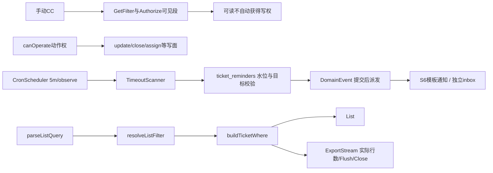

<a id="10--p5-s10-工单协作与提醒能力设计稿"></a>

# 10 — P5-S10 工单协作与提醒能力（实施说明与设计沿革）

> 2026-11-06 ECO-B06提醒候选：max_reminders=0不发送；无实际目标或无事件注册表不消耗timeout/deadline水位，后续指定目标仍可首发；timeout候选SQL先排无目标避免占500窗口。既有先发后记、崩溃丢事件与重发取舍仍沿G-33/ADR-001。源修复e329db0已提交且专项八轮/变异通过，联合固定门禁待执行。

> 2026-11-06 ECO-B08接口校准：添加抄送的 `user_ids` 元素按standards字符串ID契约发送；DTO使用现有jsonutil.Int64Slice兼容旧数字数组并保持int64精确，正数与20项上限不变，Swagger为string[]。前端催办上级单ID同样按既有string标签发送。当前分支已修、联合门禁及真实UI复验待完成，未合main。

> **段属性**：基线段（phase5 收口对象）。**原实施序**：S6 交付后（抄送可见性/通知、超时逾期通知依赖 S6）；phase6 硬前置四件之一。
> **原规划量级（非当前排期）**：≈ 1.5–2 周（抄送 2–3 天 + 标签 2 天 + 角标 1–2 天 + 节点超时 3–4 天 + 导出含 BK-21 2–3 天）+ cron 可观测面 +0.5 天 + **`status_changed_at` 列 +0.5 天（拍板点 5，2026-10-16 外审补遗）**。**迁移**：有（`ticket_cc`/tag 两表族 + `status_changed_at` ALTER；编号启动时对账）。
> **文档定位**：段级实施说明与设计来源（2026-10-15 建档，phase5 分支）。由来 = 2026-10-09 所有者完整使用场景 vs 规划/代码差距核查（**五件全为零实现，代码级核实**）。

## 当前状态与阅读顺序（2026-11-08）

S10五批已交付：手动CC、共享标签、sections角标、节点老化/催办与工单XLSX导出。先看A.2的读写分层、A.5真实水位、A.6导出同源链，再看历史拍板来源。代码/test来源与原失败看[B27](../review/reports/zhuzhao-ecosystem-audit-b27-phase5-closeout-2026-11-07.md)及[B06](../review/reports/zhuzhao-ecosystem-audit-b06-flow-reminders-2026-11-06.md)；main/生产另计。首轮文档整理与必要本地门禁已收口，见[整理记录](../review/reports/documentation-reorganization-2026-11-08.md)，后续修改须另记验证结果。

当前只有手动CC来源；节点配置/按风险级别规则、HR manager、delivery选择、手动催办、@提及、审计导出和完整SLA仍按既有门控。BK-21本批实现List/Export同源，**新资源通用护栏泛化仍归Phase6 Week0**。§2“零实现”与原周数仅是立项历史。



水位不在message_log；事件派发与水位持久化也不是Outbox同事务保证。badge.todo与消息中心待办列表各有当前状态定义，见A.4。

## 1. 定位与由来

所有者完整使用场景描述暴露五件协作/提醒缺口（抄送/标签/角标/节点超时/导出），2026-10-09 差距核查逐件代码级核实零实现后立项。phase6 依赖四件：风险工单按等级自动选抄送人（抄送 cc 规则）/风险事件打标签（标签）/新风险事件角标（聚合计数）/节点逾期按级别通知（节点超时）——**S10 缺席则四能力降级**（手动抄送/固定筛选/无角标/仅风险单级 deadline）。

<a id="2-现状基线代码级锚点2026-10-15-核实"></a>

## 2. 立项基线（历史）（代码级锚点，2026-10-15 核实）

| 项 | 现状 | 锚点 |
|----|------|------|
| L2 可见集 | 属主（created_by/assigned_to）∨ org 锚点子树 ∪ 委托轴（BK-13 三支 SQL）——**无 watcher 通道** | `internal/service/ticket/resource.go` `GetFilter`/`delegatedVisibilitySQL`（≈:140-176） |
| 抄送/标签/角标/超时/导出 | **五件零实现**（ticket_cc/tag 表、聚合计数端点、timeout_minutes、审计/工单导出端点均不存在，2026-10-15 grep 核实；zhuzhao 仓内零 excelize/CSV 导出） | — |
| keyword 搜索 | title ILIKE（转义）+ 纯数字 ID 精确匹配 | `internal/repository/ticket_repo.go` ListTickets 条件构造（≈:145-154） |
| cron 设施 | P4 收归的进程内 CronScheduler（ticker + pg advisory lock + ReentrantJob 契约）已就位，现仅 audit_archive 一任务；**无清单读端点/上次成功时间/失败告警**。**调度分工口径（2026-10-20 规划研究回灌，D18，依据 docs/proposal/secops-platform/08-phase5-adjustments.md）**：CronScheduler 只承接平台维护型扫描（超期 / 到期 / 对账 / GC），业务 / 拉取 / 脚本类周期工作一律 taskrunner——本段 timeout_scan 属维护型，骑 CronScheduler 口径成立；phase6 三个扫描任务同理 | `internal/service/cron_scheduler.go`；`internal/app/app.go:52-61,104` |
| SLA 死存储 | `tickets.sla_due_at` / `ticket_types.default_sla_hours` **从不写入**（只读兼容） | `internal/model/ticket.go:21,46` |
| 通知依赖 | 抄送可见性通知/超时通知的通道与模板 = S6 交付物 | [06-s6](./06-s6-message-notification.md) |

## 3. 五件设计要点

### 3.1 工单抄送（CC）

- `ticket_cc` 表 + 请求/事件扩展；**抄送人来源三档**：①手动选人；②流程节点配置（S2 节点 meta 增 cc 规则——依赖 S2 适配层扩展）；③按级别规则（phase6 风险工单按等级自动选抄送人——依赖本件的规则挂点）。
- 抄送者可见性与通知走 S6（业界对标 Jira watcher）——**抄送落库成功后 emit `ticket.cc_added`**（DomainEvent，06 号 A.1 枚举：S6 message_rules 订阅抄送通知；无此事件=通知须硬编码进 cc_service 违 06 号 §5.2 禁令；随 B10-1 落，2026-10-16 评审批）。
- **抄送 × L2 可见性拍板点（表设计前必拍）**：现 L2 可见集无 watcher 通道（§2）——phase6 头号场景"风险工单按等级抄送安全负责人"，安全负责人通常**不在业务 org 子树内**，按现 L2 **连工单都打不开 = 抄送失效**。二选一：
  - **① "抄送即可见"L2 特例通道（推荐）**：cc 用户并入 GetFilter/Authorize 可见集（Jira watcher 同语义）——注意与既有三轴的合取关系（特例=新增 OR 支，fail-closed 哨兵与 BK-21 泛化同批对表）；
  - ② 选人限定在可见范围内——**砍掉 phase6 场景，不可取**。
- **⚠ 表设计对表项（2026-10-15 核对发现）**：[phase3/10 §10.1](../phase3/10-ticket-business.md) 类型级可见性策略蓝本已设计 **`ticket_participants(ticket_id, user_id, role∈{participant,cc})`** 独立 m2m 表（翻案重启点 = 「工单恢复批」，**未立项未排期**）。本段落 `ticket_cc` 前须与其对表：若可见性批先落，cc role 已有承载、`ticket_cc` 勿重复建；若本段先行，表设计**须预留 role 语义**（单表 cc/participant 可演化 vs 分表）或显式拍分表——**两批谁先启动谁对表，防同语义双表**。

### 3.2 用户自定义标签

通用 tag 表（entity_type + entity_id + tag 文本，用户级）挂工单/风险事件——**补充而非替代**既有固定筛选维度；筛选项前端透出。**可见性语义（⚠ 2026-10-16 外审提出歧义——拍板点 6，B10-2 前拍）**：「用户级」两解 = 每人私有 vs 用户创建共享——安全协作场景下私有标签削弱价值。**建议默认共享**（标签内容非敏感、可见性随工单 L2、表带 created_by 留痕；跨用户"标签治理/改删权限"出现再升级），B10-2 前确认。

**姊妹挂账：@提及（触发驱动，2026-10-16 全计划业界对标补——Jira/GitHub/Slack 协作标配，本段未设计）**：评论/描述中 `@用户名` 解析 → 被提及者**通知**（走 S6 模板）+ **可见性**（提及是否纳入可见集 = 轻量版抄送，随拍板点 1「抄送即可见」口径对齐）；量级 1–2 天（解析+通知挂载+解析限流防滥用）。触发 = 协作场景真实出现。

### 3.3 待办角标（轻量提醒，≠站内消息中心）

2026-11-08 M-4补登记：消息中心待办使用与首页相同的assigned/in_progress两状态口径，`src/views/message/center/index.vue` 的 `fetchTop`/`todosQuery`按固定页大小拉前K条、ID倒序归并再分20条，不含closed且不在50条截断；这是6a95fd2a既有实现的补登记，非新增后端分页能力。完整工程边界见[06号A.9](06-s6-message-notification.md)。

- 右上角角标 = 待办工单数（assignee=me）+ 新风险事件数（phase6）；实现 = **聚合计数端点**（一次查多计数，替代现状首页每状态一次 total 的权宜）+ 前端定时轮询（60s 级）。
- **端点按 sections 可扩展结构设计**（2026-10-09 补遗）——phase6 增风险事件计数**零改协议**；S6 二期未读数聚合并入同一端点 sections（[06-s6 §6](./06-s6-message-notification.md)）。
- 站内消息流不入本段（翻案后挂 S6 二期——本段角标 = 铃铛一期形态）。

<a id="34-节点级超时--逾期分级通知"></a>

### 3.4 当前节点超时、催办与deadline边界

`ticket_types.transition_meta`按state键配置timeout/escalation，S3a的`from>to`键用于转换语义，两者共存。`CreateTx/UpdateStatusTx`同语句写`status_changed_at`；AssertTransition是事务前校验，不能充当写入或事件发布点。

TimeoutScanner由CronScheduler维护型扫描驱动，`tickets.timeout_scan_tick`当前默认5m，`timeout_observe=true`默认只记录候选不发通知。类型页已有per-state超时/催办表单，不再以JSON专家模式当未交付兜底；画布节点编辑仍为后续触发项。

催办水位在`ticket_reminders(ticket_id,state,reminder_count,last_reminder_at)`：无escalation段为一次assignee通知；有段缺省间隔240min/最多3次，显式max_reminders=0停止。候选SQL先排除无实际目标、额度已满和间隔未到的行，避免占据LIMIT500窗口；无注册表/真实目标不耗水位。当前先派发再写水位，落水位失败可重发、进程崩溃仍可丢事件，G-33/ADR-001既有取舍不变。

supervisor当前仅工单人工指定`escalation_supervisor_id`（Create/Assign可写）；处理人/指定上级由扫描器并成payload.cc_users，S6一条cc规则发送。已拍进阶为人工指定优先、HR manager其次、缺席不推导；HR尚未接，组织管理员推导已作废。`delivery`仍是未来UIP契约偏好，不是当前扫描器或Message字段已透传能力。

`sla_due_at`已随S3a/000071激活为SLA0.5 deadline模型A，deadline扫描沿同一事件/水位设施。它不等于完整SLA计量；暂停/业务日历/升级链仍按§5硬触发评估。dd§29只给轻量方向，细分边界是当时设计推演，不能冒称所有者逐条永久否决。

### 3.5 工单/审计导出（P4-4 未兑现部分）

- P4-4 实际落的是 **al 域导出**（activelist `GET /data/:typeName/export`，经网关代理）——**审计/工单查询结果导出（excelize 固定列）在 zhuzhao 仓内零端点**（2026-10-15 核实），当前本件只补齐工单XLSX导出；审计查询导出仍是挂账目标，不因标题含“审计”就标已交付。
- **端点形态对表注（2026-10-15 公约审计补，standards §3）**：导出属查询语义，形态随批（GET 复用筛选参数为预置方向）；**流式/大结果集属 §3-6「游标仅用于机器全量迭代链路（同步/导出）」的许可场景**——流式/keyset 不进管理台分页信封；与审计导出挂账项（[README §5](./README.md)，`GET /audit/logs/export` 蓝本=activelist 流式导出）统一对表，勿两处漂移。
- **当前BK-21范围**：工单导出与List共用parse/filter/where三层构造及既有哨兵，导出不越查询可见性；新资源通用护栏泛化仍归Phase6 Week0，不能将本域同源关单扩大到所有未来repo。
- 关联挂账：审计日志按需导出（筛选即导出形态，2026-10-15 用户提出）登记于 [README §5](./README.md)——**触发驱动不占基线**，若与本件撞期可合并实施（蓝本同 = activelist 流式导出）。

## 4. 启动拍板点

| # | 事项 | 建议 |
|---|------|------|
| 1 | 抄送 × L2 可见性 | **"抄送即可见"特例通道**（③选人限可见范围不可取）；与 BK-21 泛化同批对表 |
| 2 | ticket_cc vs ticket_participants 表形态 | 已按S10先行实施ticket_cc并预留role；participant只是预留，不表示完整参与人功能已交付 |
| 3 | sla_due_at/default_sla_hours 去留 | 后继已由S3a激活SLA0.5 deadline，旧deprecated建议不再适用；完整SLA仍按§5触发 |
| 4 | 导出格式 | excelize 固定列（P4-4 al 域同款）；CSV 流式形态仅审计导出挂账项按需 |
| 5 | **节点超时时间源（2026-10-16 外审补遗）** | **新增 `status_changed_at` 列**（`UpdateStatusTx` 咽喉内同写——2026-10-19 两轮修正：AssertTransition=tx 前纯校验不可作锚；中间版锚 B3-1 端点有排期倒挂[晚于 B10-4 交付]，终版锚 repo 层唯一状态写咽喉[存量 Close/Assign 与 B3-1 端点全经它]——推荐 a 案）；ticket_events 反查不取（完整性依赖+JOIN 成本）；B10-4 前确认，量级 +0.5 天 |
| 6 | **tags 可见性语义（2026-10-16 外审补遗）** | **默认共享**（created_by 留痕；可见性随工单 L2）——私有标签诉求出现再加 owner 限定；B10-2 前确认 |

> **状态注（2026-10-16）**：本表拍板点已随批量预确认拍定（2026-10-16 所有者「按建议」——✅34/🔶1，状态 SSOT = [11 号 §4](./11-implementation-plan.md)；各段启动时异议可翻，翻案成本=改一行）。

## 5. 边界（不做）

- **不滑向完整 SLA 引擎**（边界已钉：无计时表/无升级链/无暂停恢复）。
- **SLA 业界对表 + 升级触发信号（2026-10-16 审计姊妹批——文档化"为什么不建引擎"）**：业界完整 SLA 六组件=目标定义（scope+goal）/计时模型（**事件式 start-stop-pause**，JSM·ServiceNow·Zendesk 同构）/多级阈值预警（75/90/100%）/违约升级链（escalation 自动转派）/达成率报表/业务日历（工作时段计量）；**时钟三模型**：A 截止时间戳（`sla_due_at`是当年模型A字段、现已被SLA0.5激活——暂停/日历不可支持）/B 计时器事件（业界主流）/C **状态老化检测（本件=模型 C）**——C 不是 A/B 的劣化版而是独立成熟形态（GitLab health 衰减/GitHub stale bot 同款：运营提醒语义，非服务承诺计量）。**设计理由五条**：无消费者不建引擎（最高纪律）/复杂度不对称（aging 0.5 天 vs 完整 SLA 2–4 周+SLA 定义本身即管理负担）/§23 暂缓域纪律/aging 为独立形态非劣化/`status_changed_at` 已是模型 B 事件地基（升级不推翻）。**升级触发信号（硬触发任一即立项；软信号两条以上启动评估）**：硬=①对外承诺响应/解决时限（进 SLA/合同）②停表语义（等客户期间不计时的考核场景——**aging→SLA 分水岭**）③业务日历（非 7×24 运营）④达成率 KPI 考核 ⑤超时自动升级链；软=超时通知被普遍忽略（阈值语义需细化为"承诺剩余时间"）/phase6 整改 deadline 升格监管承诺/平台对外服务化。**升级形态预置**：`status_changed_at` 保留 → 加 `sla_timer_events`（ticket_id+event[start/pause/resume]+at）+ goal 定义表（JSM policy 同构）+ `timeout_minutes` 保留为 aging 提醒层与 SLA 计量层**并存**（两档语义不冲突）。**引擎可嵌入性结论（2026-10-16 补——"有没有现成可直接用"）**：独立可嵌入的开源 SLA 引擎**基本不存在**（生态真空：SLA=业务规则×状态机×时钟语义的耦合体，只沉淀在平台内不独立成库）——开源仅两形态均不可嵌入：①整套 ITSM 平台（JSM/ServiceNow/Zammad——SLA 为内置模块，引入=换整个工单系统）②通用工作流定时器原语（Camunda Boundary Timer/Temporal Timer——能表达但需把工单流程搬进其运行时，架构代价远超 SLA 本身）；Go 生态零 SLA 语义库。**立项时=自研计量层 1–2 周**（难点在语义设计——start/stop/pause 必贴自身状态机，引库省不掉；实现为纯 SQL/Go 事件回放+阈值比较，`status_changed_at` 地基已在；设计借 JSM policy 模型，不引代码）。**四层落地路径**：层 0 aging（已有）→ 层 0.5 **deadline 模型 A**（工单 due_at 字段+按 deadline 扫描+到期通知——phase6 R2 deadline 蓝本现成，几小时级，可先顶"固定时限承诺"且让 `sla_due_at` 复活；**✅ 后继已随S3a/000071实施；10-19的W15为当时排期来源**）→ 层 1 模型 B 完整 SLA（硬触发命中，1–2 周自研）→ 层 2 平台级 ITSM 永不（自研平台不换）。
- 站内消息流不入本段（S6 二期）；实时推送不做（轮询分期口径，S6 §6）。
- 标签不做权限级可见性（**默认共享 + created_by 留痕**——拍板点 6 口径；跨用户标签治理随场景另议）。
- 迁移两表族编号启动对账（A2）。

## 6. 影响面

- **迁移**：已落000062 CC、000063 tags、000064超时四件套、000065导出API；000071的SLA0.5为S3a跨稿引用。真实迁移见A.3与控制台，不再按旧草图重取号。
- **权限**：导出走 GetFilter 同管线（BK-21 泛化同批）；抄送特例已进入GetFilter及Authorize可见段，canOperate不扩写权；通用新资源护栏仍单列。
- **消费方**：S6（抄送/超时通知）、phase6（四件依赖 + 风险关单对账扫描继承 cron 观测面）、S2（节点 meta cc 规则）。
- **前端**：详情页抄送人区/标签编辑、全局角标（布局层）、工单列表导出按钮；审计导出按钮未实现。

<a id="7-实施序与批次建议"></a>

## 7. 原实施序与已执行批次

原顺序为S6后实施，五批已交付；以下保留批次来源，当前范围以A节为准。批次：①抄送（含 L2 特例通道 + 表形态拍板）→ ②标签 → ③角标聚合计数端点 → ④节点超时 + cron 可观测面 → ⑤导出 + BK-21 泛化。②③与①无硬依赖可并行；⑤依赖 BK-21 排期对齐（与 phase6 谁先启动谁触发）。

## 8. 验收口径

- 后端随四档 acceptance；前端走 ui CI + E2E + 场景走查。
- 场景标尺：抄送安全负责人（org 子树外）→ 其列表可见该单 + 收到通知（拍板点 1 成立的正向）；**非抄送且三轴外用户不可见404**（可见但无写权才403）；角标端点一次请求返回多 sections；节点超时扫描触发分级通知 + cron 状态端点可见上次成功；导出行数与同筛选列表一致（可见性同源断言）+ 无权限用户导出 403。
- 回归：现 L2 三轴判定零变化（特例支纯增量）；sla_due_at 去留处置后存量单零影响。

## 9. 文档衔接

| 文档 | 关系 |
|------|------|
| [phase3/10 §10](../phase3/10-ticket-business.md) | ticket_participants 蓝本对表项（§3.1 ⚠）；类型级可见性批 = 潜在前置 |
| [06-s6](./06-s6-message-notification.md) | 通知通道/模板/未读数 sections；实施序前置 |
| [02-s2](./02-s2-flow-graph-designer.md) | 画布范围界注互指（meta 编辑不在 S2——transition_meta 编辑归本段 B10-4 管理面/S3a B3-1） |
| [phase6/README §3](../phase6/README.md) | 四件依赖与降级说明；cron 观测面继承方 |
| [review/11 §8 BK-21 行](../review/11-project-control.md) | 护栏泛化触发实锤（导出/抄送特例支同批） |

---

## 附录 A：详细技术设计（实施级，2026-10-16 补充——样板深度对齐 05 号附录 A）

> ⚠ 标注 = 实施级设计建议（启动批确认制，不新增拍板点）。**拍板点 1–6 已全部批量预确认**（2026-10-16，11 号 §4 台账 S10#1–6 ✅）。

<a id="a1-模块架构与代码落点"></a>
<a id="a1"></a>

### A.1 当前模块与代码落点

`internal/service/ticket/cc_service.go`的`AddCC/RemoveCC/ListCC`负责协作，`resource.go`的`GetFilter/Authorize/canOperate`负责读写分层；`tag_service.go`负责共享标签，`badge_service.go`的`BadgeService`按section注册计算器。TimeoutScanner仍在`ticket/timeout_scanner.go`，**没有engine子包实施**。

`internal/service/cron_scheduler.go`和CronRegistry承载调度/started_at等观测；`internal/handler/system_handler.go`的`CronStatus`输出只读状态。导出handler在`internal/handler/ticket_export.go`的`TicketHandler.Export`，不是旧树里泛写的ticket_handler.go实现体。

UI当前使用`src/components/NavbarBadge.vue`、详情CC/标签区、类型超时表单，以及`src/api/ticket/index.ts`等封装；不存在已建成的collab.ts公共模块。审计导出与engine子包仅为旧目标路径，当前图中不画实线。

<a id="a2-l2-特例通道实现拍板点-1-已批量预确认新增-or-支--fail-closed-哨兵同批"></a>
<a id="a2"></a>

### A.2 当前CC读写分层

CC只扩读可见集：`Resource.GetFilter`新增ccVisibilitySQL，`Resource.Authorize`的**可见性段也调用IsCC**；随后仍执行`canOperate`，不能用“Authorize不加CC”概括。抄送人能看不能因此update/close/assign。

自抄送/自摘/列表要求read；抄他人/摘他人要求update。AddCC数据库写入成功后调用emitCCAdded，重复挂载仅对新增的人发事件；没有把异步通知放进DB事务。所有路径仍走L2同源，非CC且其它轴不可见404，可见而动作不允许403。

当前来源仅手动；节点配置、按级别规则以后各批接入，role=participant是表语义预留。通用Registry/BK-21新资源泛化仍在Phase6 Week0，不把CC本体增强误作全域护栏完成。

<a id="a3-表族-ddl迁移全文级编号启动对账"></a>
<a id="a3"></a>

### A.3 当前迁移与数据设计

| 迁移 | 当前承载 |
|---|---|
| `000062_ticket_cc.up.sql` | ticket_cc，role预留cc/participant、唯一挂载与user反查索引；CC模板/规则种子 |
| `000063_tags.up.sql` | entity_type/entity_id/tag共享标签，created_by留痕与幂等唯一键 |
| `000064_ticket_timeout.up.sql` | transition_meta、status_changed_at、escalation_supervisor_id、ticket_reminders水位、活跃单索引及通知/观测种子 |
| `000065_ticket_export_api.up.sql` | 工单导出GET绑定ticket_list读面 |
| `000071_sla_due_at.up.sql` | S3a跨稿的SLA0.5截止时间及deadline通知种子 |

实际DDL以`migrations/`文件为准，完整编号SSOT仍是[控制台§4](../review/11-project-control.md#4-数据库迁移地图81-对)。旧三表族SQL并未涵盖最后实施的四件套，不能当当前建表脚本。

CreateTx/UpdateStatusTx与状态写同语句维护status_changed_at；原存量回填updated_at是近似值，故默认observe。ticket_reminders按(ticket_id,state)记水位，不因看到status_changed_at更新就自行推断水位已清零；状态代际/重入边界沿现有G-33记录，未在本轮改造。

<a id="a4-角标聚合端点b10-3"></a>
<a id="a4"></a>

### A.4 当前角标与待办定义

GET `/api/v1/badges`是登录态自服务，data.sections为开放map。ticket域注册todo，inbox装配后注册unread，未来risk可另注册；单section失败记录日志并省略该项，不整体500。

`BadgeService.todoCount`当前计assignee=me且status不在closed/rejected；消息中心待办列表则只拉assigned/in_progress两源。两者定义不同，不承诺数字相等或覆盖未来全部自定义状态。unread已实现，不再以“二期—”占位。

`NavbarBadge.vue`以VueQuery订阅既有badge失效key，已读后重取并保留60s后台同步；请求失败保留上份成功数据，见B20。开放map是协议扩展点，不等于未来所有section已经存在。

<a id="a5-节点超时扫描器b10-4"></a>
<a id="a5"></a>

### A.5 当前扫描、水位与观测

CronScheduler按配置启动timeout_scan（默认5m）；started_at区分已注册与已启动，observe默认只记候选。扫描器解析state级timeout/escalation及SLA0.5 deadline，维护型任务归CronScheduler，业务/脚本周期工作仍归taskrunner。

实际去重/额度不是message_log查询，而是ticket_reminders：无段单发，有段缺省240min/3次，max=0停。SQL在LIMIT500前排除无目标/已满/未到间隔候选，shouldRemind复核水位；无注册表或无真实目标不消耗首发机会。间隔未到的二扫不重发，达到间隔且额度未满可继续催；不能把“同状态只发一次”当当前多轮合同。

扫描器只Dispatch DomainEvent，目标已解析到cc_users，S6 rules决定外发模板；ops失败告警走ops.cron_failed，fixed空收件人种子需管理员配置才发送。先派发再bumpReminder的失败可重发，进程崩溃/消费者失败不由此获得可靠投递保证；不把该水位等同Outbox或已送达回执。

<a id="a6-导出端点b10-5"></a>
<a id="a6"></a>

### A.6 当前工单导出（B10-5）

审计`/api/v1/audit/logs/export`仍是挂账目标，不存在已交付端点/按钮。当前TicketHandler.Export→Service.ExportStream与List共用parseListQuery/resolveListFilter/buildTicketWhere；这是本域同源，不等于新资源BK-21泛化完成。

```
GET /api/v1/tickets/export              # 与 List 同筛选参数（GET 复用，§3.5 对表注）
```

- **逐行编码**：excelize `StreamWriter`——表头/数据逐行写入缓冲，库按阈值落临时文件；取行结束后 `Flush` 收尾并校验错误，再封装 XLSX 写 HTTP 响应，所有返回路径 `Close` 清理临时文件；行数钳制（⚠ 对齐审计导出挂账口径 ≈5 万，超出 400 提示收窄筛选）；挂既有 rate_limit 桶；
- **并发增删口径（B06-F16，2026-11-06）**：COUNT只作快速预检；实际生成流的第50001行必须终止并400，丢弃尚未发送的工作簿，不返回截断文件。成功审计的rows等于实际写入文件的数据行数，不能沿用预检总数；同筛选List行数/行集一致断言以数据未并发变化为前提，不承诺两次独立查询共享读快照。
- **BK-21 铁律落地**：导出查询**调用与 List 同一个 filter 构造函数**（代码级同源——cc 特例支/三轴自动一致），验收断言「导出行数 = 同筛选列表 total」；
- 响应：`Content-Disposition: attachment; filename=*.xlsx`（RFC 5987）；审计落行（谁/筛选/行数——对齐审计导出挂账的「导出自审计」业界标配）。

<a id="a7"></a>

### A.7 验收补充（在 §8 基础上）

- cc 特例四向：org 外 cc 用户列表可见 + detail 可开；**非cc且三轴外不可见404**；cc 用户 update/close **403**（canOperate不因CC扩权；Authorize可见段有CC）；删 cc 后可见性即时回收；
- 超时链路：造候选 → 扫描 → `ticket.timeout` 事件 → 规则通知；间隔未到二次扫描不重发，有escalation时按额度/间隔可继续；状态时间与持久水位分别断言，不虚称自动重置；
- cron 观测：状态端点可见 timeout_scan 上次成功/耗时；注入失败 → `ops.cron_failed` 事件（BizType=ops）→ 告警规则触发；
- 导出：同筛选行数一致断言；无权限 403；超行数钳制 400；xlsx 打开可读（列头/编码）；
- tags：跨用户共享可见（B 见 A 挂的标签）；重复挂载幂等；按标签筛选与列表联动。

---

## 变更记录

| 日期 | 变更 |
|---|---|
| 2026-11-08 | 文档整理：CC可见段与动作权、提交后emit、真实ticket_reminders/5m/observe、多轮额度、现行迁移/导出与待办统计分层，补实际链路图；保留历史决策，不改业务。 |
| 2026-11-08 | §3.3补UI既有M-4两源top-K待办分页登记，回链06号A.9，不扩大状态/快照一致性承诺 |
| 2026-10-15 | 建档（phase5 分支十段设计稿批）——现状锚点逐段代码核实（五件零实现负向核查）；含 participants 对表项（2026-10-15 核对发现）；未新增决策 |
| 2026-10-15 | 公约对表批：§3.5 导出端点形态对表注——查询语义 GET 为预置方向、流式/keyset 属 §3-6 机器迭代许可场景不进管理台信封，与审计导出挂账统一对表 |
| 2026-10-16 | **第一批外审回声批（两设计缺口落档）**：§3.4 补**时间源前置**（tickets 无 `status_changed_at` 列——代码级核实；推荐新列 AssertTransition 同事务写，拍板点 +5，量级 +0.5 天）；§3.2/§5 补 **tags 可见性语义拍板点 +6**（「用户级」歧义——建议默认共享+created_by 留痕，B10-2 前拍）；头部量级/迁移行同步 |
| 2026-10-16 | **详细技术设计批（附录 A，实施级——05 号样板深度）**：A.1 模块架构（cc/tag/badge/timeout_scanner 四服务落点）/A.2 **L2 特例通道语义分层**（cc 支进 GetFilter 读可见集=全路径自动生效、**不进 Authorize 操作授权**——抄送人能看不能改；Registry 登记+BK-21 同批哨兵）/A.3 三表族 DDL 全文（ticket_cc 带 role 预留防 participants 双表/tags 共享+UNIQUE 幂等/status_changed_at+部分索引+**存量回填近似性警示**——首跑观察模式或重置二选一）/A.4 角标 sections 开放 map 契约/A.5 超时扫描器（**复用 S6 规则面**：扫描器只发 ticket.timeout DomainEvent、S6 message_rules 路由通知零新通知代码；message_log 查重防重发）+ cron 可观测面（Status()+只读端点+cron.failed 事件告警）/A.6 导出（流式 StreamWriter+行数钳制+**与 List 同 filter 函数同源断言**+导出自审计）/A.7 验收补充（cc 四向/超时链路/cron 观测/导出四向/tags 三向负向） |
| 2026-10-16 | **全计划业界对标批（所有者）**：§3.2 补姊妹挂账 **@提及**（触发驱动——Jira/GitHub/Slack 协作标配：解析→通知+可见性[随拍板点 1 口径]，量级 1–2 天） |
| 2026-10-16 | **badge 注册制批（实施线详设+A.1 补注）**：badge_service 计算器注册制（各域注册 section 计算函数，handler 只编排——防 phase6 往 ticket 域塞 risk 计数）+ 定位注（跨域枢纽宿主 ticket 域可接受，phase6 注册时再议升位）——外审评审确认设计方向 ✅ |
| 2026-10-16 | **评审批 cc_added 事件补（深审项 A）**：§3.1 抄送落库同事务 emit `ticket.cc_added`（DomainEvent——S6 message_rules 订阅抄送通知的订阅依据；无此事件=通知须硬编码进 cc_service 违 06 号 §5.2 禁令）；06 号 A.1 枚举行同步 |
| 2026-10-16 | **SLA 业界对表与升级触发批（所有者问"为什么这样设计/后续对齐业界的触发事件"）**：§5 边界补 SLA 业界对表注——六组件/时钟三模型（A 截止时间戳=B 纪元 B 事件式/C 状态老化=本件）/设计理由五条/**升级触发信号清单**（硬五条：对外承诺·停表语义[分水岭]·业务日历·达成率考核·自动升级链；软三条）+升级形态预置（sla_timer_events+goal 表+aging/SLA 两层并存——status_changed_at 即模型 B 地基） |
| 2026-10-19 | **SLA 边界溯源修正批（所有者质询"四件边界从哪里来"——考古发现标注瑕疵）**：dd §29 原文（行 1447 实证）仅方向性定论「刻意轻量不做完整 SLA 引擎」一句，**未列四件细分**；git log -S 考古：三连（无升级链/无暂停恢复）首现于 9e7b856 S10 立项批=规划写作时从完整组件清单减法的**设计推演**、业务日历第四件首现于 d79af12 业界对表批——原「dd §29 定论，边界钉死」表述将推演产物冠以定论引用（标注纪律瑕疵，BK-16 同族）；§3.4 修正为三层溯源（方向定论=§29/四件=设计推演/真实锚点=§23 纪律+隐性场景假设[内部无承诺诉求]+触发信号清单硬五条）——**边界=当前态非永久钉死，假设失效或信号出现即重开** |
| 2026-10-19 | **timeout_minutes 承载结构修正批（外审全面审计 P1——三方矛盾：代码 transitions=纯邻接表无边属性位/02 号画布签名 Record<string,string[]>+后端零改动/S3a transitions_meta 列 W13–15 晚于 B10-4 W9–11）**：修法 (a) 拍定——`ticket_types.transition_meta` JSONB 一枚 ALTER **随 B10-4 建**（state 级键存 timeout_minutes），S3a 扩展 "from>to" 键复用同列（一列两用、">" 区分键形）——§3.4 主句/§6 迁移行/§9 衔接行/A.3 DDL 补第③枚/A.5 扫描逻辑句五处修正；「零 DDL」口径废止；**timeout 编辑面=B10-4 管理页或 JSON 专家模式（S2 画布不承载——与 02 号界注对齐）** |
| 2026-10-19 | **gap2 排期确认级联（随 03 号——所有者确认）**：§5 四层路径层 0.5 处补「✅ W15 随 S3a 同窗顺带排期」（deadline 模型 A——phase6 前核心引擎目标态收口件；transition_meta 列本段 B10-4 交付、S3a 复用扩展） |
| 2026-10-19 | **P0-2 写入点口径修正批（并行外审合并报告）**：拍板点 5/A.3 DDL 注/§3.4 写入点三处——「AssertTransition 同事务写」→「**统一转换执行入口事务内同写**」（AssertTransition=tx 前纯校验 service.go:352 vs :357 实证——写点锚定 B3-1 `POST /tickets/transition` 事务内） |
| 2026-10-19 | **P0 修正批二轮回声（写点终版锚——消排期倒挂）**：拍板点 5/A.3 DDL 注/§3.4 三处「统一转换执行入口事务内同写」→「**`UpdateStatusTx` 咽喉内同写**」——上批中间版锚 B3-1 端点（W13–15）晚于 B10-4 扫描器（W9–11）：W11–W13 窗口存量 Close/Assign（service.go:363/:432）不经新端点、该列持续 stale=扫描器新漂移；终版锚 repo 层唯一状态写咽喉，存量路径与 B3-1 封装全经它，**B10-4 交付时点即全量正确** |
| 2026-10-24 | **B10-4 前端编辑面 + B10-5 导出交付（ui 9d117dd4/5a2bf84d、zhuzhao dcdd757）——S10 五批全清 🔵 待走查**：①B10-4 前端：类型编辑框「超时与催办」per-state 表单面（状态下拉取当前图 states/超时分钟/催办对象处理人·上级复选/间隔/次数——前端校验对齐后端含间隔 ≥5 节流窗口径；引用已删状态行丢弃提示）；发起页+分派对话框「催办上级」UserPicker（dd §31 基线档；assignTicketApi 第三参 nil=保持不动）；TicketRow 增 status_changed_at/escalation_supervisor_id。②B10-5：**新依赖 excelize v2.11**（替代 csv 不符拍板点 4 形态/tealeg 停维护）；**BK-21 同源三件套**（parseListQuery/resolveListFilter/buildTicketWhere——导出与列表 handler/service/repo 三层同一构造，可见性零漂移+IW4 哨兵覆盖导出路径）；GET /tickets/export 15 固定列 StreamWriter 流式+5 万钳制 400+导出自审计（流式挂 v1 级独立链免通用审计二进制捕获——files 先例；手动落行谁/筛选/行数）；迁移 000065 绑 ticket_list（GET 与列表同受众）+**2a 断言校准 9→10 设计内增长**（000042 批 8→9 先例）；列表页导出按钮（同筛选透传 blob 下载）。验证=TestB105 三子测（BK-21 行数+行集双一致/不可见零行/tag·keyword 联动/50001 行钳制 generate_series 直插）+集成三包+22 包+往返 65 对+四档 247/0（2a 校准后）；ui 四件绿 |
| 2026-10-24 | **B10-4 节点超时+催办后端交付（zhuzhao 62c03c2）——E-1/E-2 当日拍定当日落**：①迁移 000064 四件套+A.3 DDL 全文级（transition_meta/status_changed_at/escalation_supervisor_id/ticket_reminders+部分索引）+种子两枚+cron-status menu_apis 绑 audit_log；②写入点：CreateTx/UpdateStatusTx 同事务写 status_changed_at（E-2 终版锚——零漂移窗口）；Create/Assign 增可选 escalation_supervisor_id（**E-1 改写：人工指定>HR manager_id[M-HR 后]>缺席，角色码推导作废——dd §31 通则**）；③UpdateTicketType 收 meta+validateTransitionMeta（键⊆states/notify 词表 assignee·supervisor/**间隔 ≥5min 下限**——小于 S6 60s 节流窗的配置会被吞，校验层挡在配置面）；④timeout_scanner（D18 骑 CronScheduler）：水位判定（无段=单发/缺省 240min·3 次）→ ticket.timeout 事件 cc_users=assignee∪人工指定上级（**实施偏差：supervisor 不做 recipient_type 第四枚举**——目标集由扫描器在 emit 时解析进载荷，一条种子规则[cc 档]全员可达，规则面零扩枚举）；观察模式 config `tickets.timeout_observe` 默认 true（回填近似值防误报——**运维步骤：cron-status 确认首跑无异常后置 false**）；⑤cron 观测面（A.5 收口）：CronRegistry+GET /system/cron-status（observe 标记透出）+SetOnFailure→ops.cron_failed 事件（BizOps 新域）→S6 规则告警（种子收件人 empty=暂不发送，管理员配置后生效）；⑥**MessageDispatcher 抽出（B-6 销账）**：编排链整体迁 dispatcher.go，hook 薄壳+双域订阅，buildEventVars 根键按域。验证=TestB104 六+三子测（重复催办钉水位——通知面 60s 节流窗与测试时间回拨互扰在册，生产间隔 ≥5min 恒 > 窗）+纯函数单测+集成三包+22 包+往返 64 对+四档 246/0。**余**：前端编辑面（transition_meta 表单+发起/分派指定上级）、B10-5 |
| 2026-10-24 | **B10-2 标签 + B10-3 角标交付（zhuzhao caa80fe + ui 857001b6）**：①**B10-2**：迁移 000063 tags 通用表（A.3 ② 全文级——entity_type 泛型挂载 phase6 复用零改）；tag_service 授权口径=挂标签/自摘读可见（协作动作与评论同档）、摘他人挂的 update 权（轻治理底线）；ListTickets 增 tag 筛选（EXISTS 子查询——可见性由 GetFilter 管线约束，标签不旁路 L2）；三端点 selfService+catalogExempt；前端详情页标签卡（回车添加/closable 摘除）+列表筛选栏 tag 透出（URL 预填 +tag）。**坑**：TagRepo SELECT 漏 created_by 列致自摘误判摘他人 403——测试先抓（TagRow 需富化列+ID 双出）。②**B10-3**：BadgeService 计算器注册制（各域注册 section 函数、handler 只编排——phase6 risk 注册零改协议并入；跨域枢纽宿主 ticket 域=定位注既定）；ticket 域注册 todo（assignee=me 且非终态——assignee 谓词即本人可见性不走 GetFilter）；单 section 失败记日志跳过（提示面不整体 500）；GET /badges 登录态；前端 NavbarBadge（ToolHeader 挂载，60s 轮询+点击跳 assignee=me+todo=0 隐藏）。**验证**：TestB102 五子测（共享可见/幂等/筛选联动含 L2 叠加/摘他人 403/404 同形）+TestB103（todo 随分派/取消分派联动——默认图 assigned 无 closed 直转边在册）+集成三包+22 包单测+往返 63 对零漂移+四档 246/0；ui typecheck/lint/test 158/build 绿。**段内余**：B10-4（开工前拍 E-1/E-2）、B10-5 |
| 2026-10-24 | **B10-1 抄送交付（zhuzhao 111d007 + ui 34c3b751）**：①迁移 000062=ticket_cc（A.3 ① DDL——role 预留/UNIQUE 幂等/idx_ticket_cc_user 反查）+ 种子模板 ticket_cc_notify + 种子规则 ticket.cc_added→recipient_type=cc（通知走 S6 规则面零新通知代码——resolveRecipients 增 cc 档+规则面枚举/词表同步放行）②**L2 特例通道落地**（A.2 语义分层）：GetFilter 第四 OR 支 ccVisibilitySQL（列表/导出/关联查询全路径自动生效，BK-21 正交）+ Authorize 可见段 cc 支——**只进读可见集不进 canOperate**（抄送人改单/抄他人/删单 403 而非 404）③授权口径：自抄送/自摘/列表=read 面，抄他人/摘他人=update 权（可见性扩散=写面动作）④幂等挂载（事件只对本次新增人生效）+ 幻影用户 FK→400（RETURNING 流上 FK 延迟到 rows.Err() 浮出的坑在册）⑤三端点挂 selfService+catalogExempt（B5-3 附件面同款——工单操作不走静态权限码）；Resource 结构注入 CCChecker（NewResource 四参——测试三调用点同步）。**三档来源**：①手动已落；②节点配置依赖 S2 适配层扩展/S3a、③按级别依赖 phase6——随各自批次。**验证**：TestB101 六子测（A.7 cc 四向全落+幂等+幻影 400+通知到人）+集成三包绿+22 包单测+lint+**往返门禁 62 对零漂移**+**四档 acceptance 246/0（119+67+26+34）**；UI 冒烟=卡片渲染/UserPicker/前后端接线通（33333 旧二进制 404 属预期——dev 栈重启后所有者可亲手走查）；testutil 清单顺手补 000061 漏登（无断言故未爆）。**段状态 ⬜ 开工中（B10-2~B10-5 未启；B10-4 前仍有 E-1/E-2 待拍）** |
| 2026-10-26 | **外审 v4 修复批（S10 域四条）**：①**催办扫描饿死修复**（#4）：`scanState` 候选窗口 `LIMIT 500` 现只装本轮可催的单——已催满（reminder_count≥max）与间隔未到在 SQL `NOT EXISTS` 层排除；修前两类单仍占名额、循环里 skip，前 500 个催满后第 501+ 个永不催（静默饿死）；shouldRemind 保留作并发兜底。②**水位权衡登记**（#20）：先发后记——bumpReminder 失败则下轮重发（at-most-once 退化 at-least-once）；取向=宁重发勿漏催，反向在 emit 失败时漏一次且计数已耗，代码注释落档。③`AddTicketCCRequest.UserIDs` 补 `max=20`（与 Tags 同口径；#11）。④**标签摘除口径注记**（#18，判设计内）：A 挂标签后 B 再「挂」同标签是 ON CONFLICT 无操作（行 created_by 仍为 A），B 摘该标签=摘他人挂的→需 update 权→403，与拍板点 6「挂/自摘读面、摘他人 update 权」一致；UX 可改进点=挂标签接口可回告「已存在」，登记不改。另 NotifyAction 收件人 float64→int64（#6，与 CCAction 共享 idsFromParam） |
| 2026-10-26 | **手动催办演进件登记（所有者批准，触发驱动不排期）**：owner/发起人对在办工单手动发起催办——底层复用本段消息链（emit DomainEvent → S6 规则面路由，零新通知代码），**通道可选邮件/钉钉等类型**（UIP 渠道参数或 message_rules 通道映射，实现随立项拍）；与 B10-4 自动超时催办互补（手动=即时单发、自动=水位多轮），按钮授权口径与频控（复用 60s 节流窗径）随立项细化 |

| 2026-11-06 | B06-F13/P1：真实导出 handler 产物 worksheet XML 缺结束标签、超过16MiB工作表的临时文件未回收；补 StreamWriter.Flush（审计/响应头前）与 File.Close（全返回路径）。精确738原样八轮复现；修复、逐处移除修复变异及门禁状态以B06报告为准；未合main。 |
| 2026-11-06 | B06-F16/P1：原738预检49999后并发插入2行实际导出50001，删除/小增量也使成功审计沿用旧count；保留COUNT预检、实际rowFn出口守5万并按成功生成数返回。超限不静默截断，HTTP附件/成功审计在完成前均不发送。专项/变异与门禁状态见B06报告，未合main。 |
